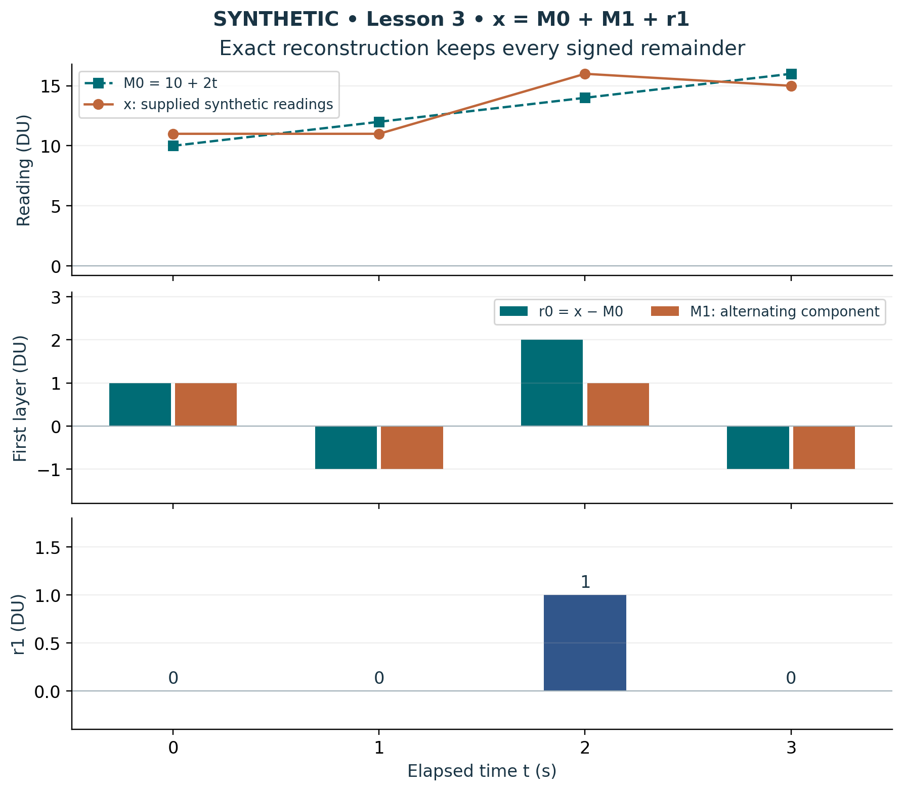

# Visual companion 1 — Retain the next residual channel

At t = 2 s, 16 = 14 + 1 + 1 DU. The lower plot keeps r1 = (0,0,1,0) DU, including every zero. The alternating component explains a chosen part of r0; its remaining row is available for the next inquiry. These are the exact synthetic Lesson 3 values.

Source and lesson mapping: [lesson-03.md](lesson-03.md).

Publication companion illustration. The cited lessons retain the definitions, assumptions, worked answers and evidence scope. Synthetic examples remain classroom constructions.
