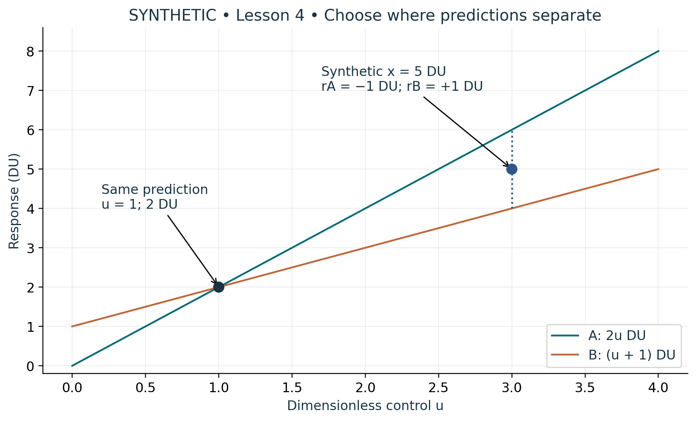

# Visual companion 2 — Choose a separating input

The two lines intersect at u = 1. At u = 3 their predictions differ by 2 DU. The supplied synthetic reading sits between them, leaving two distinct signed residuals. Neither the intersection nor equal residual magnitudes supplies a mechanism; preserve both rules and their assumptions.

Source and lesson mapping: [lesson-04.md](lesson-04.md).

Publication companion illustration. The cited lessons retain the definitions, assumptions, worked answers and evidence scope. Synthetic examples remain classroom constructions.
