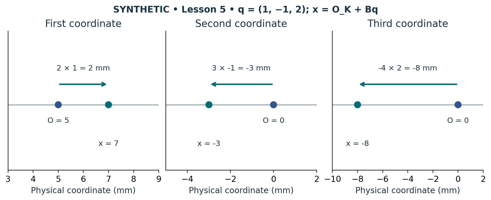

# Visual companion 3 — Read the negative direction without losing the origin

Each panel is a separate physical coordinate axis, not a view of the mature Cell3 basis. Subtract the labeled origin, then divide by that axis’s signed scale to recover q. The third coordinate moves toward negative physical position for positive q3 because its scale is −4 mm.

Source and lesson mapping: [lesson-05.md](lesson-05.md).

Publication companion illustration. The cited lessons retain the definitions, assumptions, worked answers and evidence scope. Synthetic examples remain classroom constructions.
