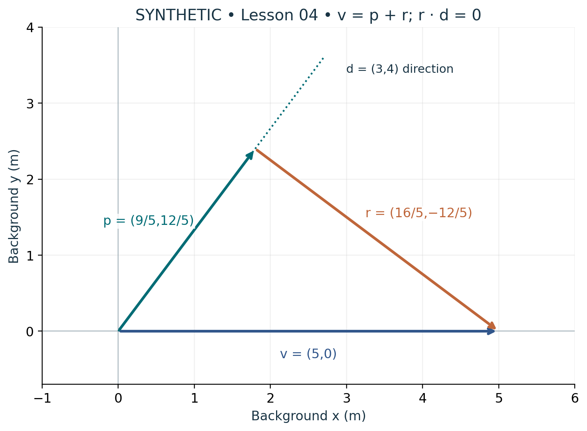

# Visual companion 1 — Projection retains a perpendicular arrow

With d = (3,4), normalize by 5 before taking the scalar projection. The parallel arrow p and the retained perpendicular arrow r close the triangle exactly: (9/5,12/5) + (16/5,−12/5) = (5,0) m. The background axes remain perpendicular.

Source and lesson mapping: [lesson-03.md](lesson-03.md); [lesson-04.md](lesson-04.md).

Publication companion illustration. The cited lessons retain the definitions, assumptions, worked answers and evidence scope. Synthetic examples remain classroom constructions.
