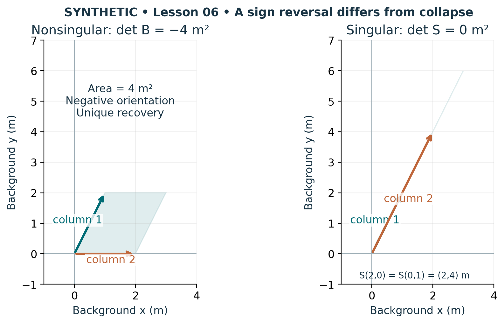

# Visual companion 2 — Orientation and information loss are separate

The ordered columns (1,2) and (2,0) enclose 4 m² with negative determinant. They still span the plane. In the second panel, both columns lie on one line; distinct coefficient pairs reach the same output. Retaining the missing input coordinate is necessary to reverse that singular map.

Source and lesson mapping: [lesson-05.md](lesson-05.md); [lesson-06.md](lesson-06.md).

Publication companion illustration. The cited lessons retain the definitions, assumptions, worked answers and evidence scope. Synthetic examples remain classroom constructions.
