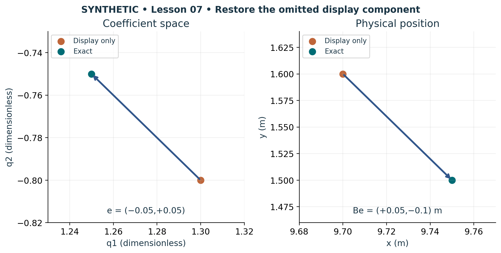

# Visual companion 3 — Restore coordinates before interpreting a display

Lesson 07 rounds (1.25,−0.75) to (1.3,−0.8), using nearest tenth with ties away from zero. The left arrow adds the signed residual e. The right arrow adds Be after mapping through B = [[1,2],[2,0]] m and origin (10,−1) m. The two panels use distinct coordinate types and axis scales.

Source and lesson mapping: [lesson-07.md](lesson-07.md).

Publication companion illustration. The cited lessons retain the definitions, assumptions, worked answers and evidence scope. Synthetic examples remain classroom constructions.
