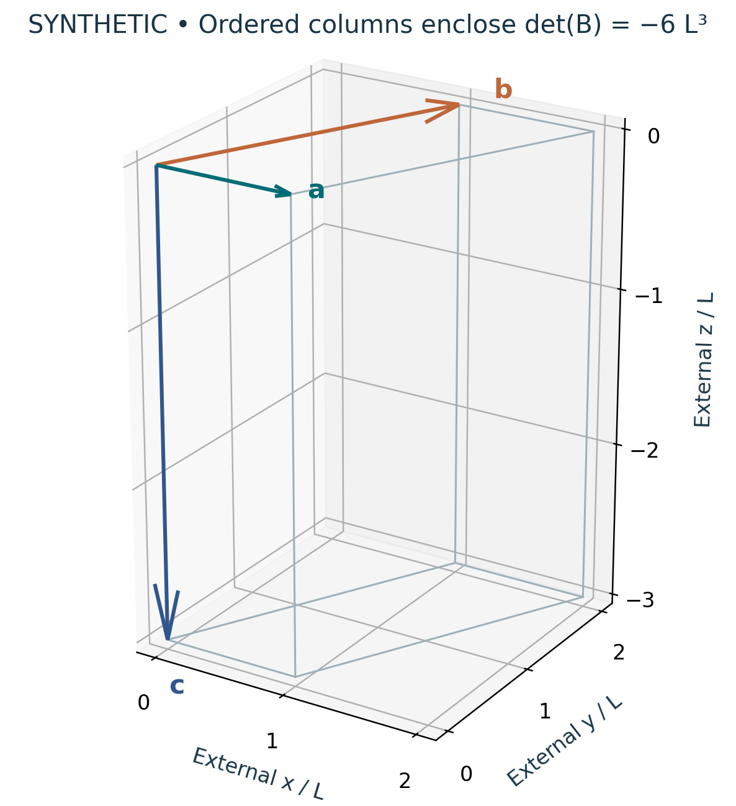

# Visual companion 1 — Read the ordered cell in external axes

The classroom analogue uses a = (1,0,0)L, b = (1,2,0)L and c = (0,0,−3)L. Its ab face has area 2L²; the third edge supplies height 3L with negative orientation, yielding determinant −6L³ and unsigned volume 6L³. This figure is not the locked Cell3 basis.

Source and lesson mapping: [lesson-01.md](lesson-01.md); [lesson-03.md](lesson-03.md).

Publication companion illustration. The cited lessons retain the definitions, assumptions, worked answers and evidence scope. Synthetic examples remain classroom constructions.
