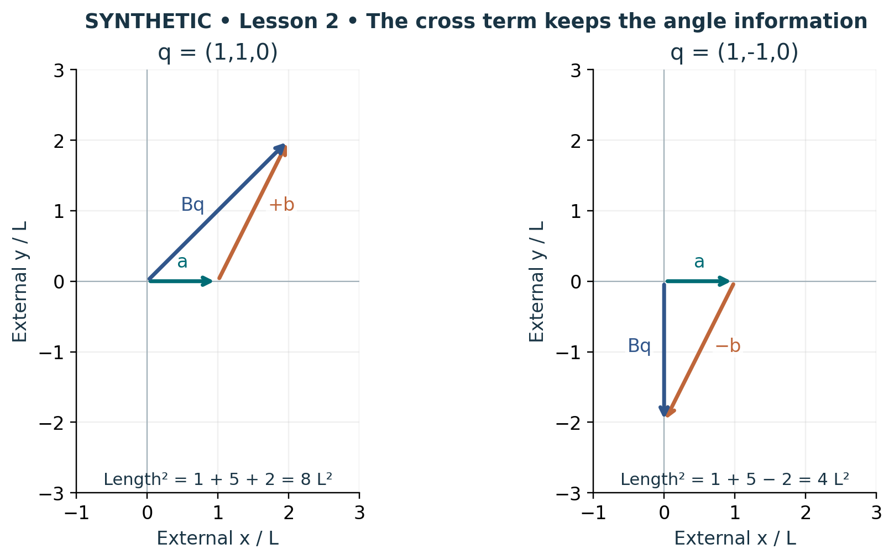

# Visual companion 2 — Cross terms retain interactions between edges

The equal diagonal contribution 1 + 5 L² belongs to both panels. The signed cross contribution changes from +2L² to −2L² when q2 changes sign. Ignoring the off-diagonal Gram entries would give 6L² for both displacements and lose the angle information.

Source and lesson mapping: [lesson-02.md](lesson-02.md).

Publication companion illustration. The cited lessons retain the definitions, assumptions, worked answers and evidence scope. Synthetic examples remain classroom constructions.
