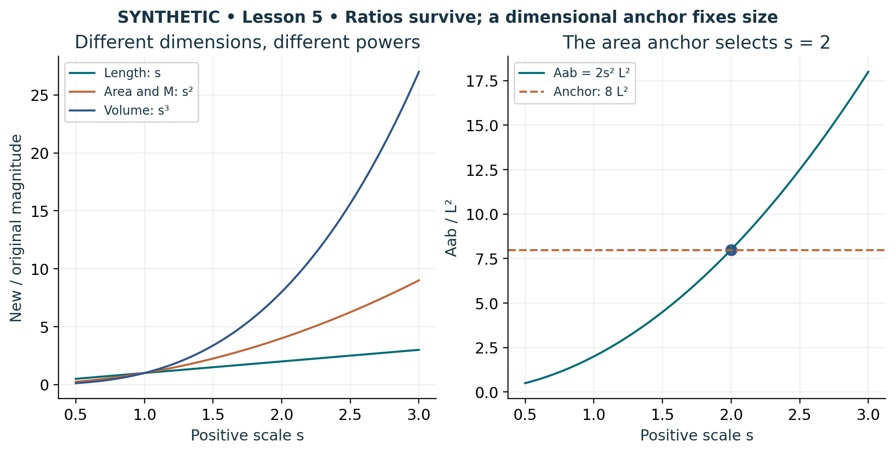

# Visual companion 3 — An area anchor fixes one positive scale

Positive scaling preserves the ordered directions and all face-area ratios. The left panel compares dimensionless scale factors; the right uses the synthetic area law A_ab = 2s²L². The supplied anchor 8L² selects s = 2. The inverse metric scales as s^−2, so its factor is 1/4 at that anchor.

Source and lesson mapping: [lesson-05.md](lesson-05.md).

Publication companion illustration. The cited lessons retain the definitions, assumptions, worked answers and evidence scope. Synthetic examples remain classroom constructions.
