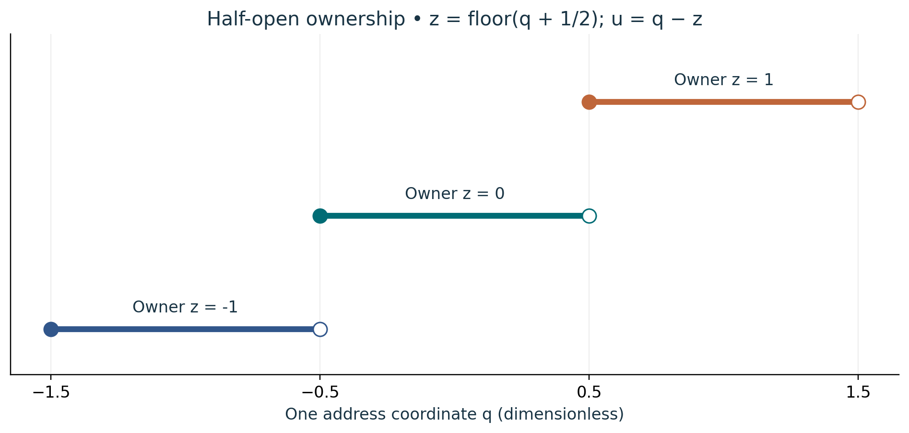

# Visual companion 1 — Give each boundary one owner

A filled endpoint is included; an open endpoint is excluded. At q = −1/2 the owner is 0, and at q = +1/2 it is 1. Both cases retain u = −1/2. The vertical separation is only for reading the three intervals, not a second physical coordinate.

Source and lesson mapping: [lesson-02.md](lesson-02.md).

Publication companion illustration. The cited lessons retain the definitions, assumptions, worked answers and evidence scope. Synthetic examples remain classroom constructions.
