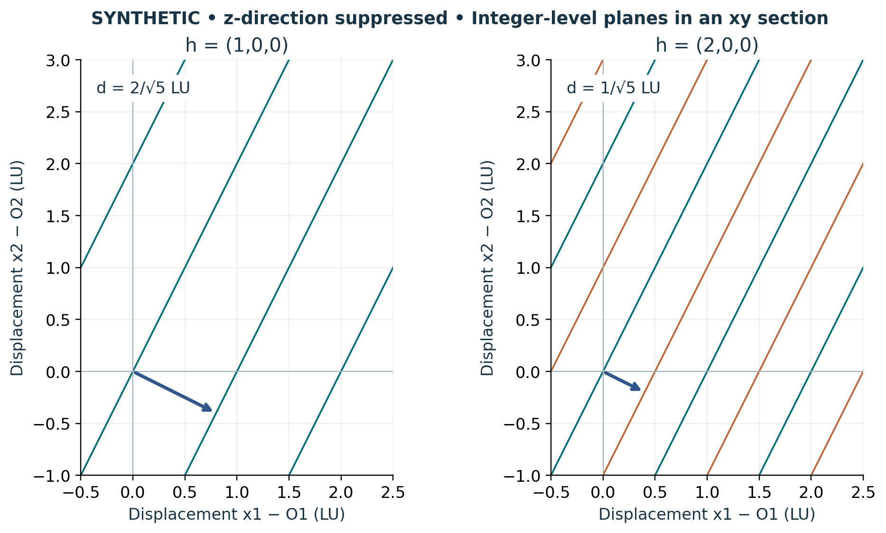

# Visual companion 2 — A reciprocal counter defines perpendicular spacing

The left panel draws d1 − d2/2 = m for integer m, where d = x−O. The normal step (4/5,−2/5,0) LU raises the level by one. Doubling h adds the orange halfway planes and halves the spacing while preserving the normal direction. These are synthetic xy sections of planes extending along the third direction.

Source and lesson mapping: [lesson-03.md](lesson-03.md); [lesson-04.md](lesson-04.md).

Publication companion illustration. The cited lessons retain the definitions, assumptions, worked answers and evidence scope. Synthetic examples remain classroom constructions.
