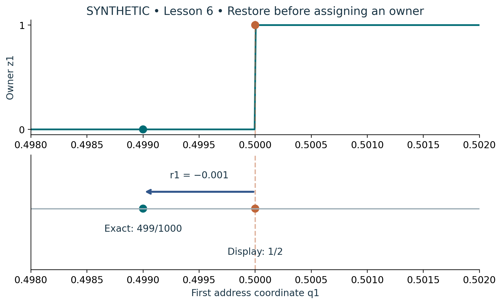

# Visual companion 3 — Restore the exact address before testing a boundary

The display 1/2 has owner 1. Adding the retained signed residual −1/1000 restores 499/1000 and owner 0. Here q2 = q3 = 0 throughout. The lower arrow is an address correction, and Br is the corresponding physical correction in LU; they are separate typed quantities.

Source and lesson mapping: [lesson-02.md](lesson-02.md); [lesson-06.md](lesson-06.md).

Publication companion illustration. The cited lessons retain the definitions, assumptions, worked answers and evidence scope. Synthetic examples remain classroom constructions.
