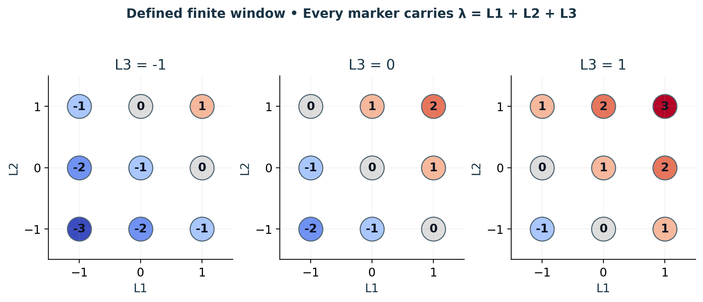

# Visual companion 1 — Enumerate every node before summarizing

Each panel fixes L3 and displays all nine choices of (L1,L2). The marker text is the integer sheet label λ. The center appears once in the middle panel; no point is hidden behind another. These are address-space slices of the defined finite window. Physical positions require the separate half-basis map.

Source and lesson mapping: [lesson-01.md](lesson-01.md); [lesson-03.md](lesson-03.md); [registry.md](registry.md).

Publication companion illustration. The cited lessons retain the definitions, assumptions, worked answers and evidence scope. Synthetic examples remain classroom constructions.
