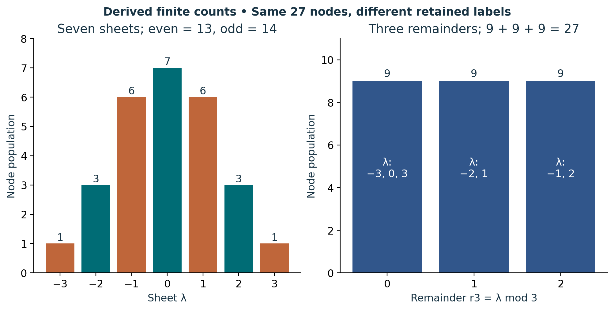

# Visual companion 2 — Keep sheet, polarity and remainder separate

Teal bars are even sheets with χ = +1; orange bars are odd sheets with χ = −1. Their populations are 13 and 14. The right panel groups by the nonnegative remainder modulo 3 and gives 9 in each class. Both are summaries of the same complete registry, and neither replaces L.

Source and lesson mapping: [lesson-03.md](lesson-03.md); [lesson-04.md](lesson-04.md).

Publication companion illustration. The cited lessons retain the definitions, assumptions, worked answers and evidence scope. Synthetic examples remain classroom constructions.
