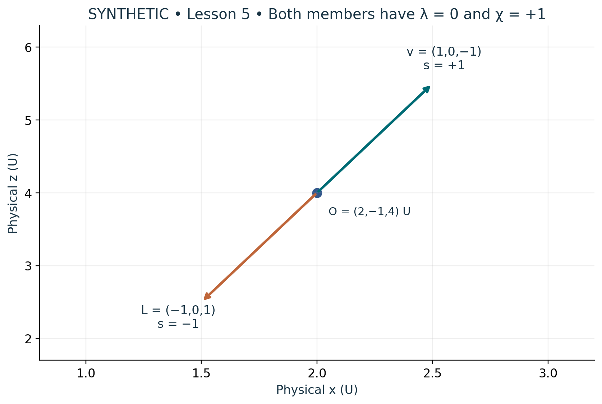

# Visual companion 3 — Pair about the declared physical origin

The xz view holds y = −1 U fixed. The two physical positions are (3/2,−1,5/2) U and (5/2,−1,11/2) U. Their midpoint is O. Both have λ = 0 and χ = +1, yet neither is the center. Retaining v and the member sign s reconstructs each directed address.

Source and lesson mapping: [lesson-02.md](lesson-02.md); [lesson-05.md](lesson-05.md).

Publication companion illustration. The cited lessons retain the definitions, assumptions, worked answers and evidence scope. Synthetic examples remain classroom constructions.
