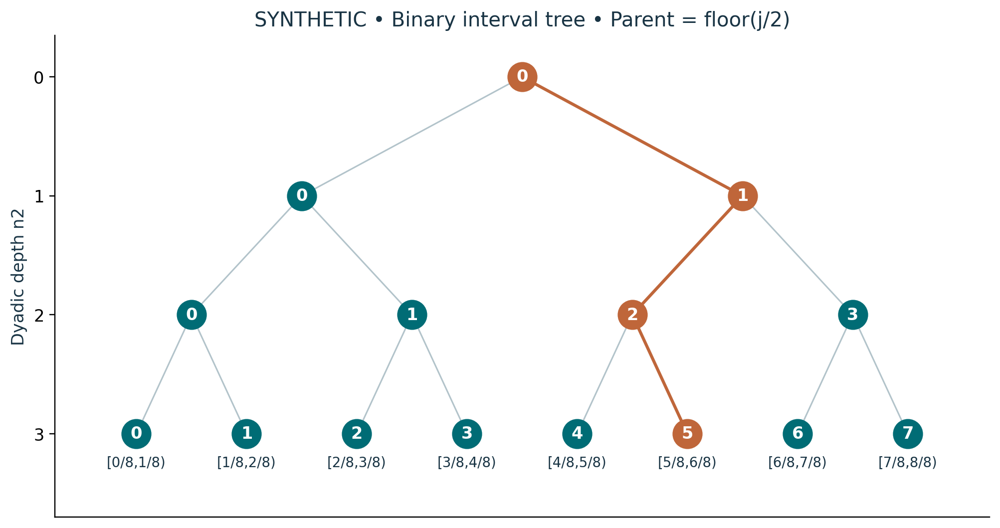

# Visual companion 1 — Trace every binary child

The orange route reaches index 5 at depth 3, interval [5/8,6/8). Its bits from the root outward are (1,0,1). Each branch reconstructs j = 2k + b. Open right endpoints are not owned; endpoint 1 remains a geometric boundary vertex.

Source and lesson mapping: [lesson-01.md](lesson-01.md); [lesson-06.md](lesson-06.md).

Publication companion illustration. The cited lessons retain the definitions, assumptions, worked answers and evidence scope. Synthetic examples remain classroom constructions.
