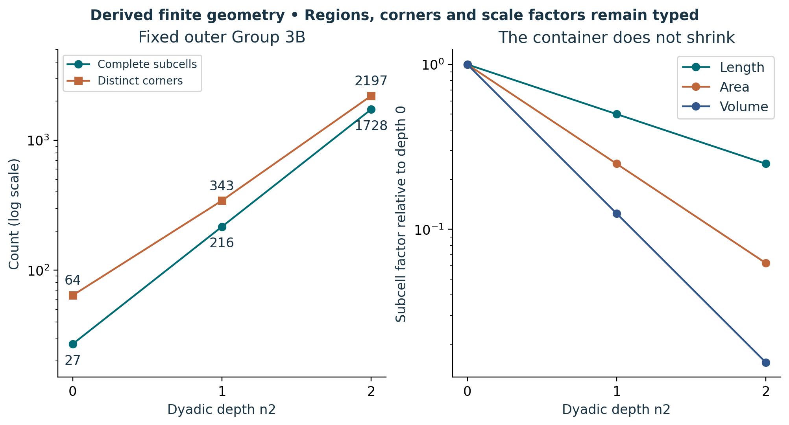

# Visual companion 2 — Count regions and boundaries independently

At depths 0, 1 and 2, the same outer Group contains 27, 216 and 1728 subcells, with 64, 343 and 2197 distinct corners. Each refinement reduces a subcell volume by 8 while increasing the number of subcells by 8. The plotted counts and factors are exact finite derivations, not measurements. Lines guide the eye between integer depths.

Source and lesson mapping: [lesson-02.md](lesson-02.md); [lesson-03.md](lesson-03.md).

Publication companion illustration. The cited lessons retain the definitions, assumptions, worked answers and evidence scope. Synthetic examples remain classroom constructions.
