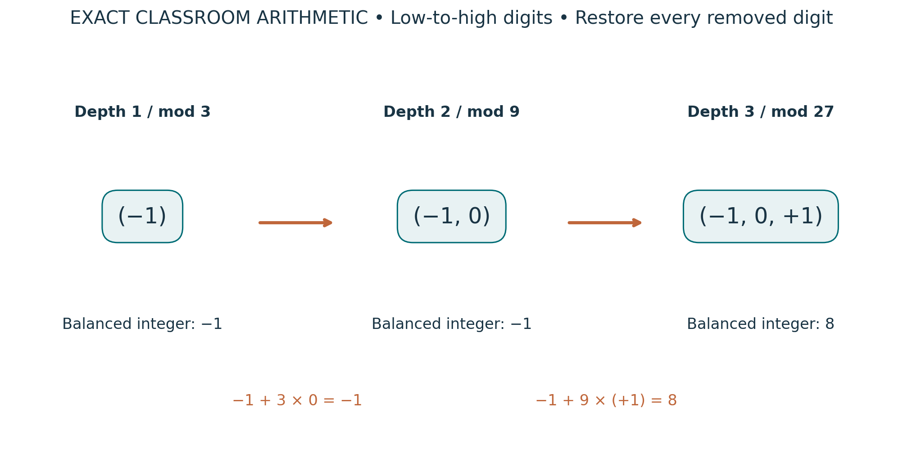

# Visual companion 3 — Reconstruct a compatible ternary history

Read the words least significant first. Reconstruction adds the removed high digit at its original place value: first zero times 3, then +1 times 9. Reversing the arrows means reducing modulo the parent modulus, not taking a binary floor. The integer representatives −1 and 8 differ, but agree modulo 9.

Source and lesson mapping: [lesson-04.md](lesson-04.md); [lesson-05.md](lesson-05.md); [lesson-06.md](lesson-06.md).

Publication companion illustration. The cited lessons retain the definitions, assumptions, worked answers and evidence scope. Synthetic examples remain classroom constructions.
