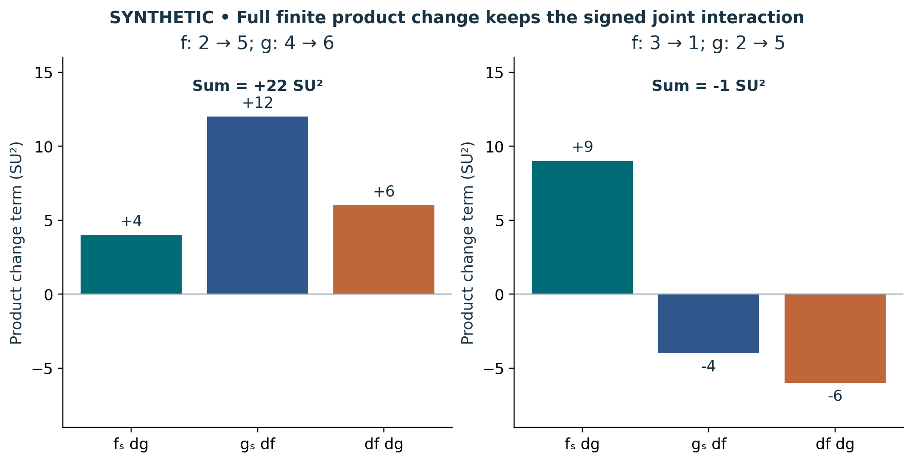

# Visual companion 1 — Keep the finite interaction with its sign

The first endpoint product changes by 30−8 = 22 SU². The second changes by 5−6 = −1 SU². In both cases the three displayed terms sum exactly to the endpoint change. The orange joint term is +6 in the first case and −6 in the second; neither is omitted.

Source and lesson mapping: [lesson-02.md](lesson-02.md).

Publication companion illustration. The cited lessons retain the definitions, assumptions, worked answers and evidence scope. Synthetic examples remain classroom constructions.
