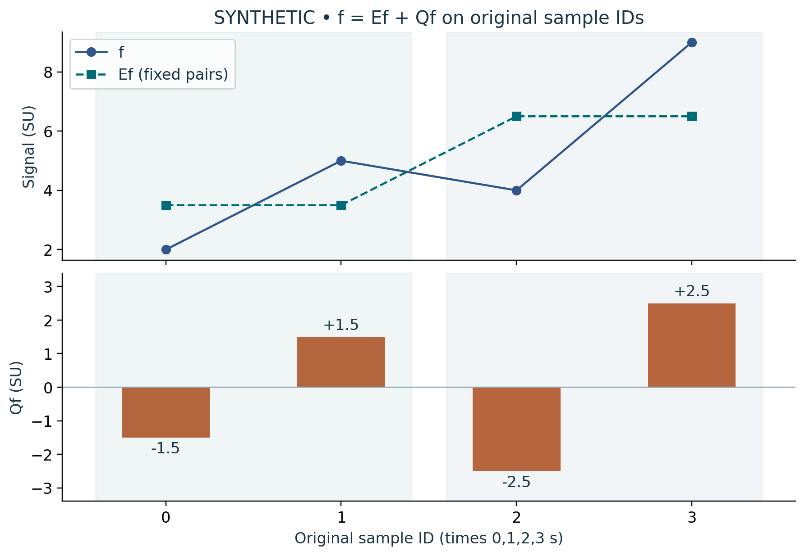

# Visual companion 2 — A mean and its detail reconstruct every sample

The shaded supports are {0,1} and {2,3}. Their means are 7/2 and 13/2 SU, and the compact signed half-differences are 3/2 and 5/2 SU. Add every lower-panel value to the corresponding coarse value to recover (2,5,4,9) SU. A zero block sum does not erase its two nonzero details.

Source and lesson mapping: [lesson-03.md](lesson-03.md); [lesson-05.md](lesson-05.md).

Publication companion illustration. The cited lessons retain the definitions, assumptions, worked answers and evidence scope. Synthetic examples remain classroom constructions.
