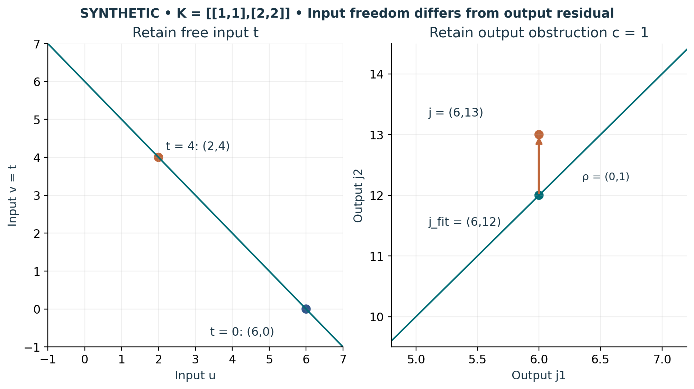

# Visual companion 3 — Preserve both sides of a singular map

Every input on u+v = 6 maps to (6,12). Retaining t = v selects the original member; t = 4 selects (2,4). The target (6,13) lies outside the reachable output line. In the declared first-equation-matching view, retain ρ = (0,1), so Kψ_fit + ρ = j. This is not an exact solution of Kψ = j.

Source and lesson mapping: [lesson-06.md](lesson-06.md).

Publication companion illustration. The cited lessons retain the definitions, assumptions, worked answers and evidence scope. Synthetic examples remain classroom constructions.
