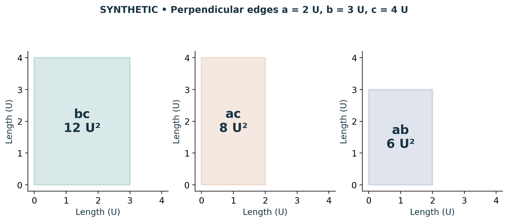

# Visual companion 1 — Name the faces before normalizing

These three rectangular faces belong to the synthetic orthogonal box, not Cell3. The common plotting scale preserves their areas in bc/ac/ab order. Dividing (12,8,6) U² by 12 U² gives (1,2/3,1/2). The retained divisor reconstructs all three areas; the ray alone does not encode the spatial angles.

Source and lesson mapping: [lesson-01.md](lesson-01.md).

Publication companion illustration. The cited lessons retain the definitions, assumptions, worked answers and evidence scope. Synthetic examples remain classroom constructions.
