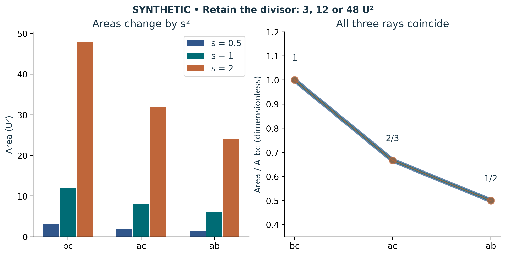

# Visual companion 2 — Change size without changing the area ray

For s = 1/2, 1 and 2 the complete triples are (3,2,3/2), (12,8,6) and (48,32,24) U². The right-hand traces coincide because both independent quotients cancel s². Category-connecting lines are reading guides, not an interpolation between faces. Retain s or the dimensional divisor to reverse the change.

Source and lesson mapping: [lesson-01.md](lesson-01.md); [lesson-02.md](lesson-02.md).

Publication companion illustration. The cited lessons retain the definitions, assumptions, worked answers and evidence scope. Synthetic examples remain classroom constructions.
