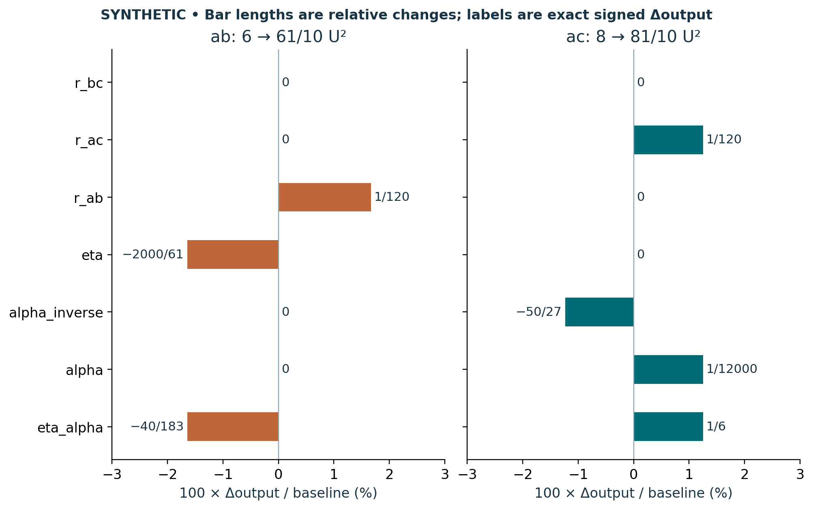

# Visual companion 3 — Keep all seven finite sensitivity coordinates

Each panel changes only the named face from baseline (12,8,6) U². Labels are the exact signed dimensionless changes; bar lengths divide them by their own nonzero baseline output to compare relative sizes. No zero coordinate is omitted. New output = baseline + labeled change. Product-path minus direct-path closure stays exactly zero in both panels, despite nonzero sensitivity.

Source and lesson mapping: [lesson-03.md](lesson-03.md); [lesson-06.md](lesson-06.md).

Publication companion illustration. The cited lessons retain the definitions, assumptions, worked answers and evidence scope. Synthetic examples remain classroom constructions.
