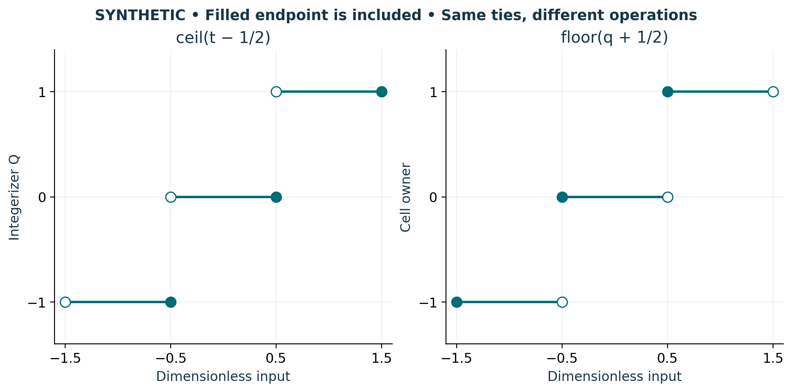

# Visual companion 1 — Specify both endpoint conventions

At +1/2 the integerizer returns 0 while ownership returns 1. At −1/2 they return −1 and 0. The integerizer retains ε = Q−t, whereas ownership retains q−owner. Both retained coordinates lie in [−1/2,1/2), but the input intervals assigned to each integer have opposite included endpoints.

Source and lesson mapping: [lesson-01.md](lesson-01.md).

Publication companion illustration. The cited lessons retain the definitions, assumptions, worked answers and evidence scope. Synthetic examples remain classroom constructions.
