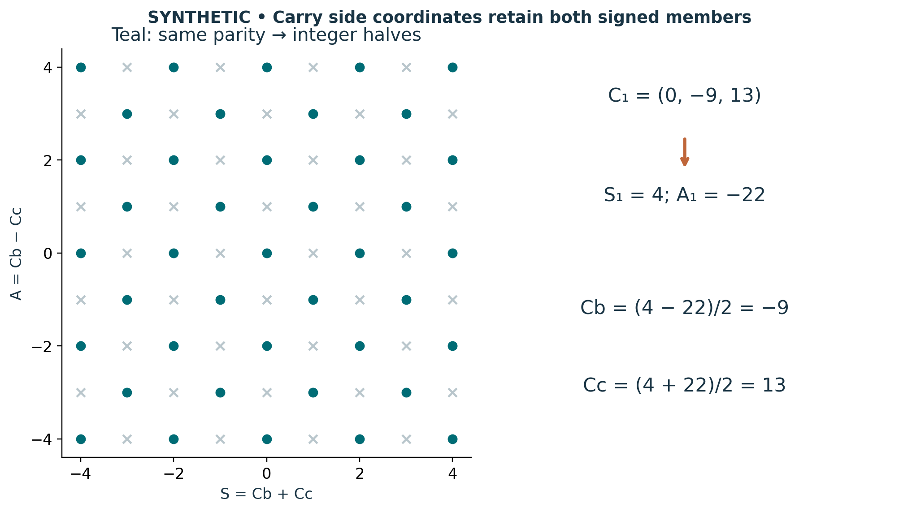

# Visual companion 2 — Invert side modes only on the parity domain

The left panel is a finite window in (S,A), not a physical lattice. Gray crosses fail the equal-parity condition; teal points give integer halves (S+A)/2 and (S−A)/2. The separate worked carry has modes (4,−22), outside the plotted window, and recovers both side carries exactly. Its a carry remains separately zero.

Source and lesson mapping: [lesson-04.md](lesson-04.md).

Publication companion illustration. The cited lessons retain the definitions, assumptions, worked answers and evidence scope. Synthetic examples remain classroom constructions.
