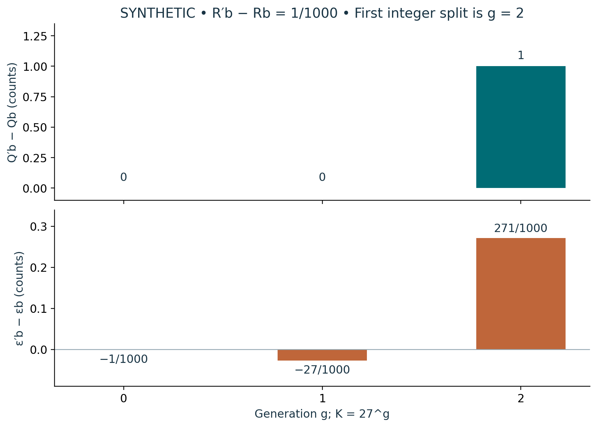

# Visual companion 3 — Integer agreement does not remove residual differences

Compare R = (1,2/3,1/2) with R′ = (1,2/3+1/1000,1/2). All differences shown are prime minus baseline. At g = 0 and 1 the integers match but the residuals differ; at g = 2 the integer difference becomes +1. At all three generations the a and c integer differences and residual differences are exactly zero. For both rays ε_a = 0 and ε_c = −1/2. The identity Δε = ΔQ−KΔr holds entrywise.

Source and lesson mapping: [lesson-03.md](lesson-03.md); [lesson-05.md](lesson-05.md).

Publication companion illustration. The cited lessons retain the definitions, assumptions, worked answers and evidence scope. Synthetic examples remain classroom constructions.
