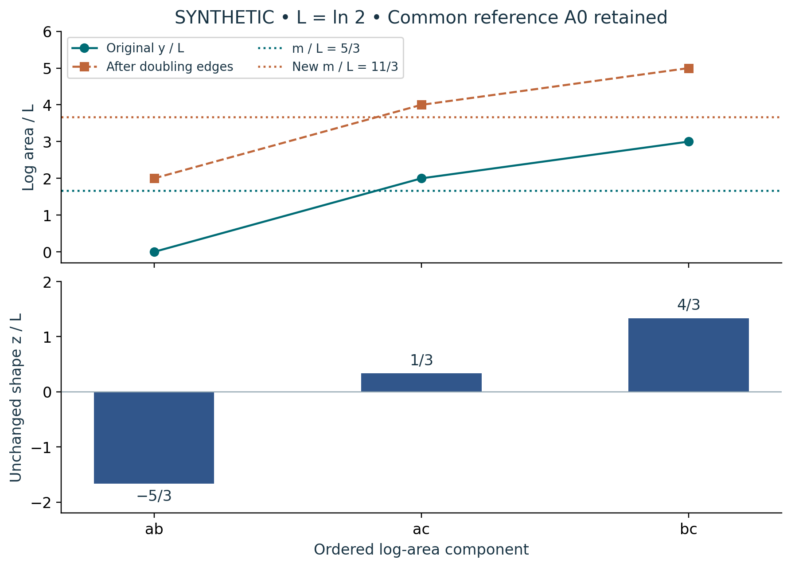

# Visual companion 1 — Separate a common shift from area shape

The original y = (0,2,3)L reconstructs areas (1,4,8)A0. Doubling every edge adds 2L to each log and moves m from 5L/3 to 11L/3. The full shape z = (−5,1,4)L/3 is unchanged and sums to zero. Reconstruct y = m(1,1,1)+z before exponentiating with the retained A0. Lines connect named components only as reading guides.

Source and lesson mapping: [lesson-01.md](lesson-01.md); [lesson-02.md](lesson-02.md).

Publication companion illustration. The cited lessons retain the definitions, assumptions, worked answers and evidence scope. Synthetic examples remain classroom constructions.
