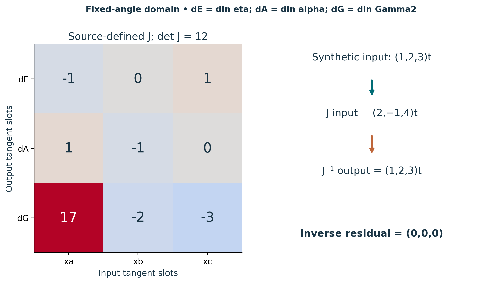

# Visual companion 2 — Keep the Jack map orders explicit

The coefficient map is source-defined; the input is synthetic. Input order is (dln l_a,dln l_b,dln l_c), output order is (dln eta,dln alpha,dln Gamma2), and all quantities are dimensionless tangents. The scalar row is tied to the named M19 gravity_scalar_lift branch. Invertibility holds for this coherent fixed-angle map; extra angle changes require additional terms.

Source and lesson mapping: [lesson-04.md](lesson-04.md); [lesson-06.md](lesson-06.md).

Publication companion illustration. The cited lessons retain the definitions, assumptions, worked answers and evidence scope. Synthetic examples remain classroom constructions.
