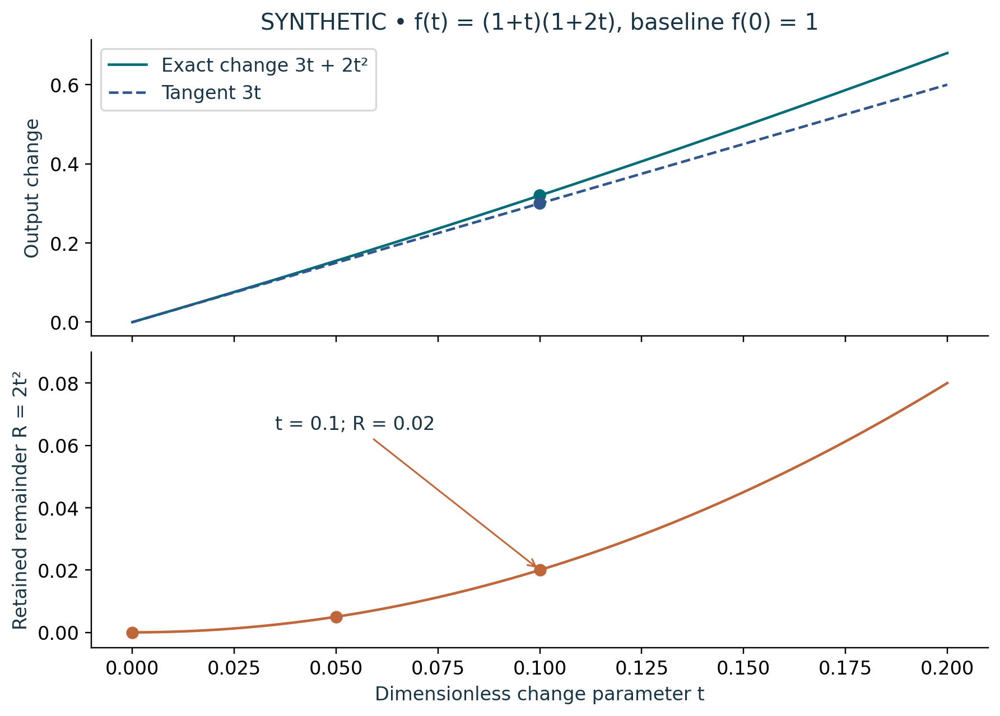

# Visual companion 3 — Retain the finite remainder after a tangent prediction

At t = 1/10, the finite change 0.32 decomposes as 0.30 + 0.02 and the output is 1.32. At t = 1/20, the remainder is 0.005. The lower panel retains the complete remainder function, including R(0) = 0; it is not a Jack inverse residual. The two checks concern separately declared maps.

Source and lesson mapping: [lesson-03.md](lesson-03.md); [lesson-06.md](lesson-06.md).

Publication companion illustration. The cited lessons retain the definitions, assumptions, worked answers and evidence scope. Synthetic examples remain classroom constructions.
