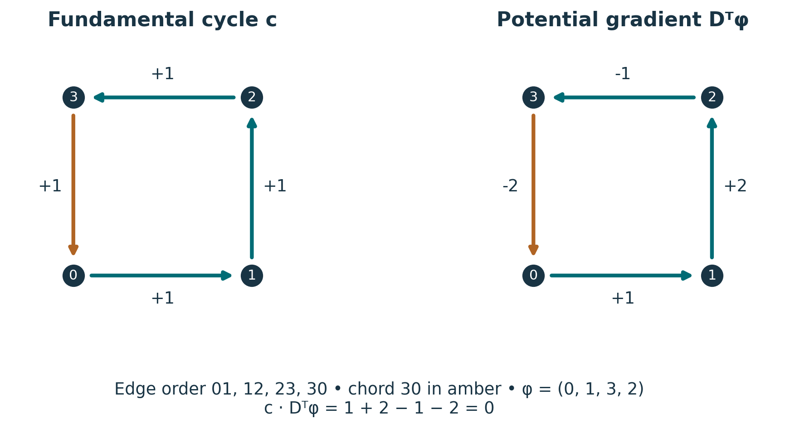
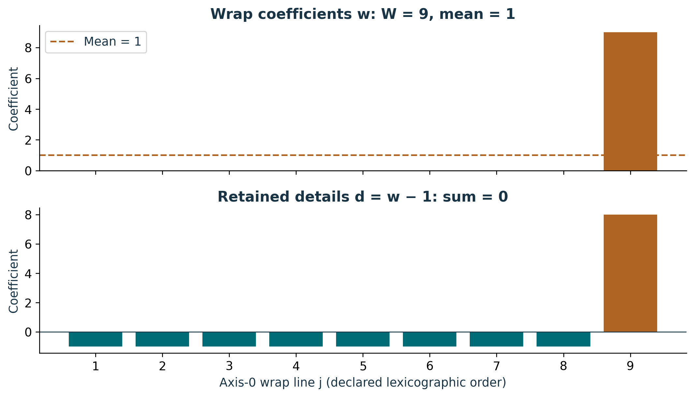
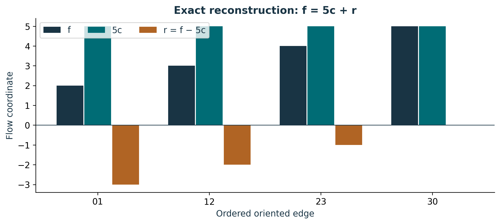

# Publication visual companion

These newly prepared teaching figures accompany the preserved lessons. Numerical examples are synthetic and dimensionless unless explicitly stated. They illustrate finite constructions and retain the specified evidence scope.

## A cycle balances; a gradient telescopes

The arrows define the stored orientation. Signed labels are coordinates relative to those arrows. The three teal edges are the spanning tree; amber 30 closes its fundamental cycle with chord coefficient +1. Each incidence row cancels on c. The gradient uses head-minus-tail potential differences, and its dot product with c vanishes. Reversing an arrow also requires negating its coordinate.

**Lesson mapping:** [Lesson 02](lesson-02.md); [Lesson 03](lesson-03.md).

# A winding retains its distribution through details

For the concentrated seam example, W=9 and the first eight details are −1. Their sum fixes d9=8. Adding W/9=1 recovers all nine original coefficients. The ninth wrap is (2,2,2)→(0,2,2); the declared tree returns through (1,2,2). Thus the complete circulation is 9h_(0,9). The 28 open coordinates, 24 independent wrap details, and 3 windings total 55; these counts do not specify a dynamics.

**Lesson mapping:** [Lesson 04](lesson-04.md); [Lesson 05](lesson-05.md).

# The remainder carries the node imbalance

The chord entry reads q=5. Its cycle contribution is (5,5,5,5), while the retained tree remainder is (−3,−2,−1,0). Their sum recovers (2,3,4,5). Because D(5c)=0, Dr=Df=(3,−1,−1,−1). This chosen tree complement is not asserted to be an orthogonal gradient component. Source scope for these constructions: S02#/backbone_sequence/7, as mapped in the original lessons.

**Lesson mapping:** [Lesson 06](lesson-06.md).
