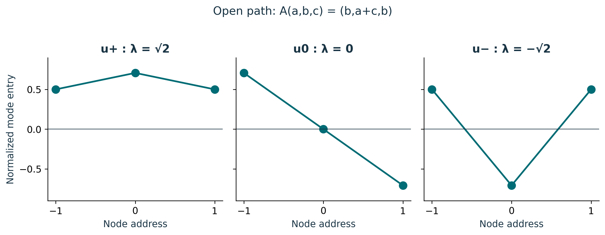
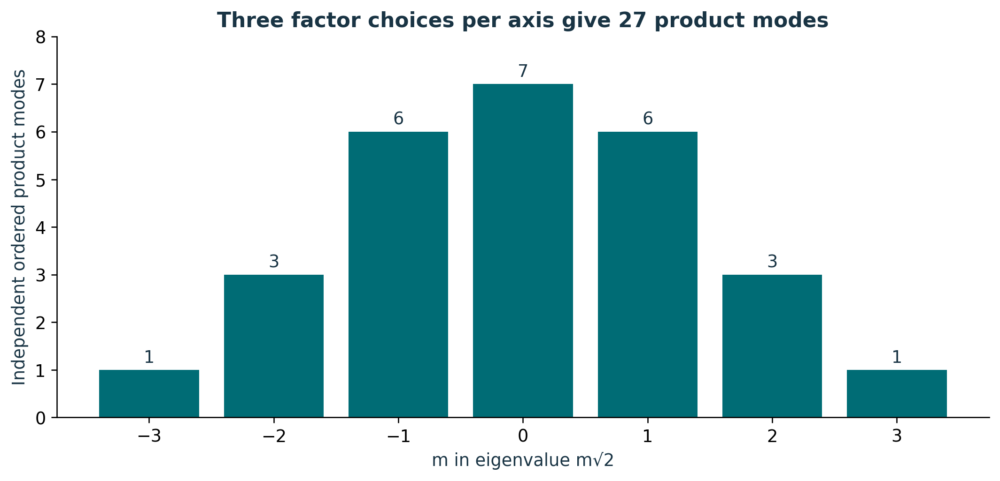
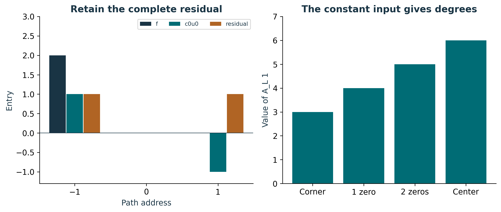

# Publication visual companion

These newly prepared teaching figures accompany the preserved lessons. Numerical examples are synthetic and dimensionless unless explicitly stated. They illustrate finite constructions and retain the specified evidence scope.

## Three path patterns, three common multipliers

The markers are the three entries, joined only to make each pattern readable. The modes in (+,0,−) order are (1,√2,1)/2, (1,0,−1)/√2, and (1,−√2,1)/2. Each has unit norm. The zero mode is a nonzero input mapped to zero. Both u+ and u− are reflection-even; eigenvalue sign and reflection parity name different operations.

**Lesson mapping:** [Lesson 01](lesson-01.md); [Lesson 02](lesson-02.md); [Lesson 03](lesson-03.md).

# Build the Emily multiplicity ledger

Each ordered triple selects u+, u0, or u− on each coordinate. Eigenvalues add. For m=0 there is 000 and all six permutations of +0−, giving seven independent patterns. The counts sum to 27. Node sheets have the same numerical list through a different counting problem; the bars here count modes, not nodes or decoder channels. Source: S02 /backbone_sequence/7/emily_spectrum.

**Lesson mapping:** [Lesson 04](lesson-04.md); [Lesson 05](lesson-05.md); [Lesson 07](lesson-07.md).

# Mode truncation and mean removal are distinct

For f=(2,0,0), mode coefficients are (1,√2,1). Keeping only the zero-mode term gives (1,0,−1), with retained residual (1,0,1). On Lucas, A_L 1 takes values 3,4,5,6 at node types with 0,1,2,3 zero coordinates, respectively. Thus the constant pattern is not an adjacency eigenvector. Separating and retaining the mean yields the coordinate count 1+13+13 without asserting deletion of an Emily eigenmode.

**Lesson mapping:** [Lesson 06](lesson-06.md).
