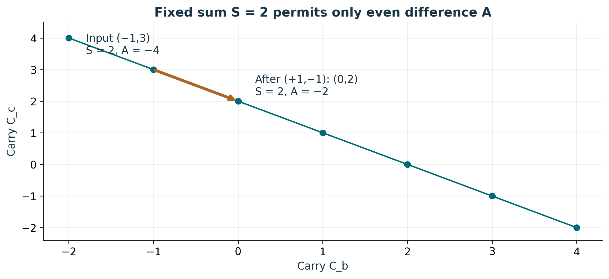
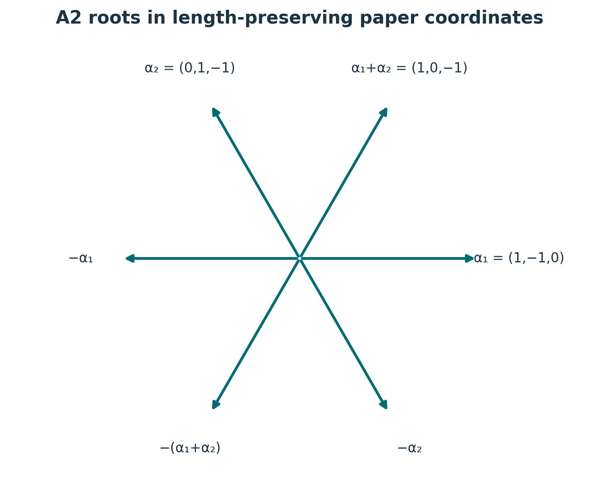
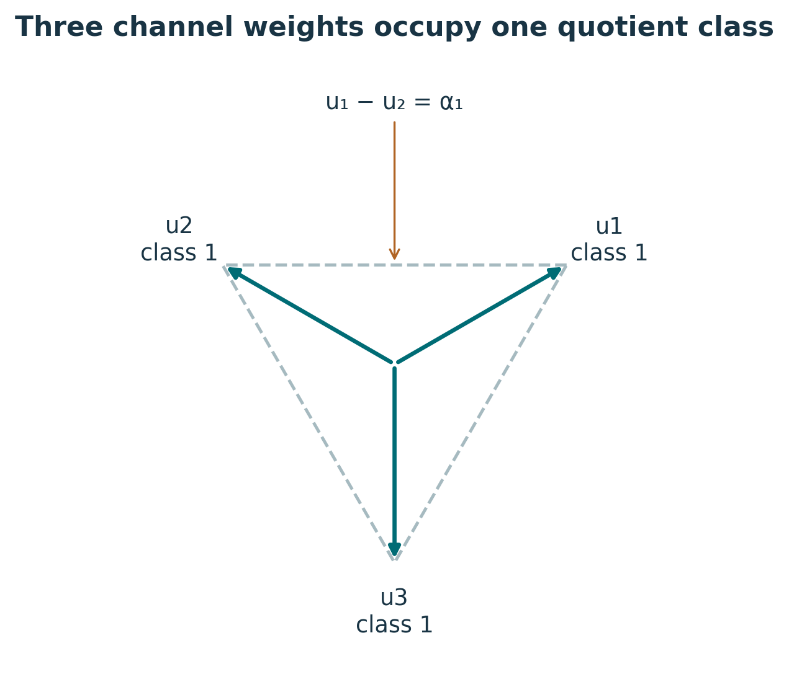

# Publication visual companion

These newly prepared teaching figures accompany the preserved lessons. Numerical examples are synthetic and dimensionless unless explicitly stated. They illustrate finite constructions and retain the specified evidence scope.

## A1 transfers move along a fixed-sum line

Each marked point is an integer carry pair on C_b+C_c=2. A forward transfer adds 1 to C_b and subtracts 1 from C_c, so A rises by 2. Retain S and A=r+2k: the input has r=0,k=−2, and the output r=0,k=−1. The parity label alone cannot distinguish them. Inverse halves (S+A)/2 and (S−A)/2 recover both carries. Source: S02 /backbone_sequence/5/side_modes.

**Lesson mapping:** [Lesson 01](lesson-01.md); [Lesson 02](lesson-02.md).

# Six transfers in the zero-sum plane

This uses the lesson’s isometric paper chart: α₁=(√2,0) and α₂=(−1/√2,√(3/2)). Tip labels remain channel triples. Every root has squared norm 2 and α₁·α₂=−1, yielding Cartan entries [[2,−1],[−1,2]]. The dot product is the abstract channel metric, not M_cell. Longer integer combinations also lie in Q₂ but are not among these six roots. Source: S02 /proof_nodes/63/formula.

**Lesson mapping:** [Lesson 03](lesson-03.md); [Lesson 06](lesson-06.md).

# Weights retain their root displacement

The centered weights u_i=e_i−(1,1,1)/3 form an equilateral triangle in an orthonormal chart of H. Each lies in class 1 of P₂/Q₂ because their differences are roots. The three quotient classes instead have representatives 0,u₁,2u₁. For w=u₁+u₂, store class 2 together with displacement −α₁: w=2u₁−α₁. Retain the removed mean when recovering e_i. These classes do not assign a family or detector parity.

**Lesson mapping:** [Lesson 04](lesson-04.md); [Lesson 05](lesson-05.md).
