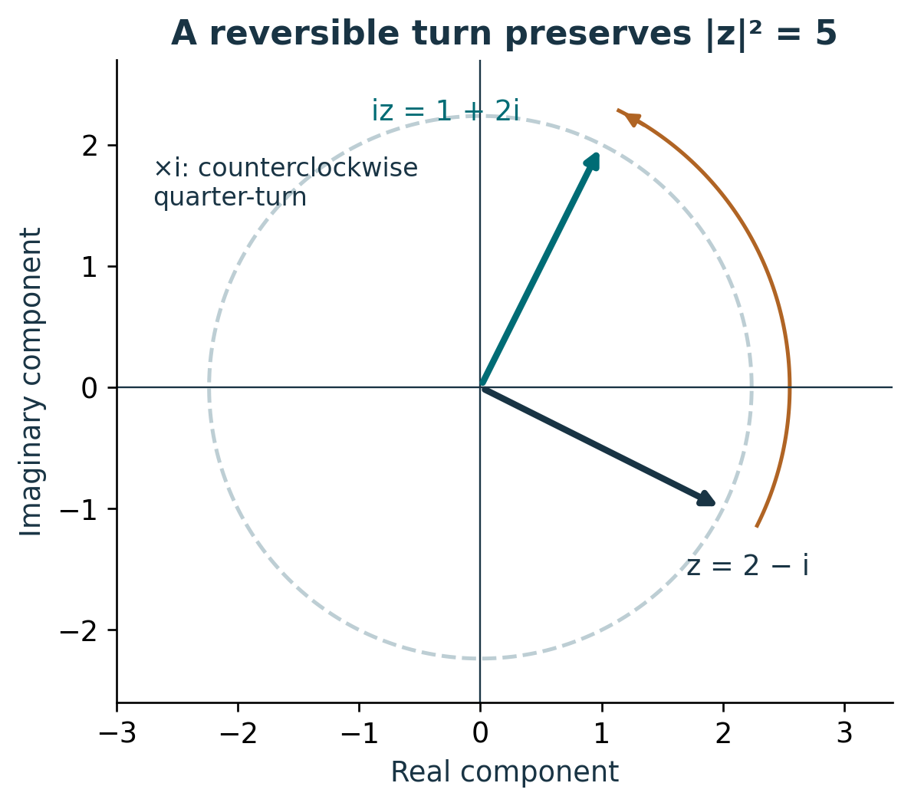
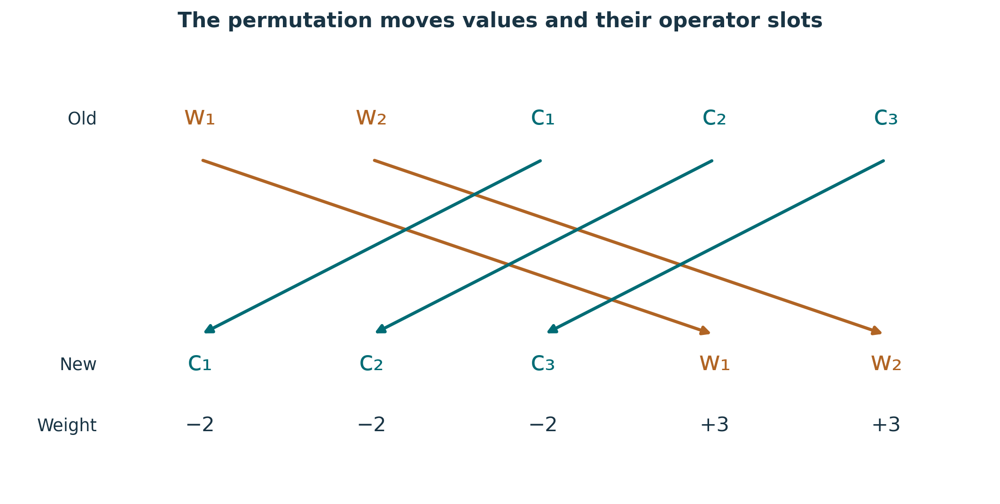
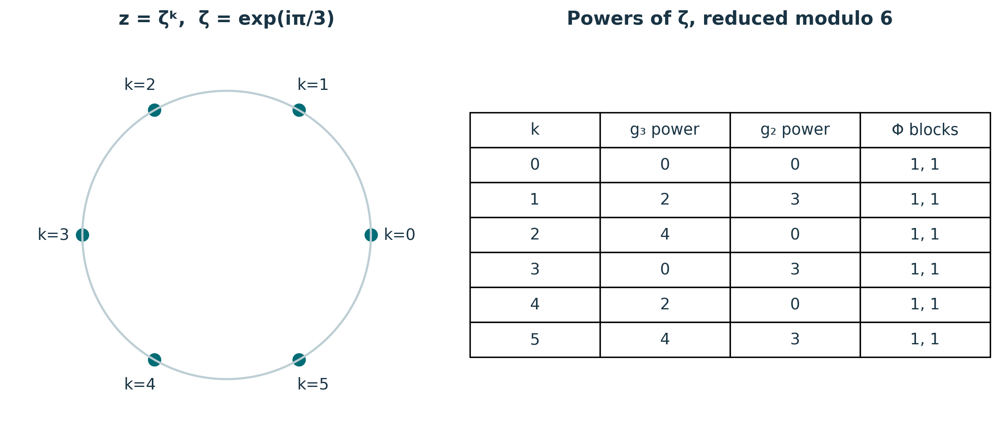

# Publication visual companion

These newly prepared teaching figures accompany the preserved lessons. Numerical examples are synthetic and dimensionless unless explicitly stated. They illustrate finite constructions and retain the specified evidence scope.

## Complex phase retains both coordinates

Multiplication by i maps (a,b) to (−b,a), hence (2,−1) to (1,2). Multiplication by −i reverses the turn. The circle records the common modulus √5, but a point on it needs a phase as well. Retain the complex number and the multiplier; the scalar modulus alone cannot recover the state. This is the synthetic practice example from Lesson 1.

**Lesson mapping:** [Lesson 01](lesson-01.md); [Lesson 02](lesson-02.md).

# Transport the block ordering with P

The arrows implement P(w₁,w₂,c₁,c₂,c₃)ᵀ=(c₁,c₂,c₃,w₁,w₂)ᵀ. Its inverse is Pᵀ. A matrix must follow A_new=P A_old Pᵀ, which transports the phase weights from (3,3,−2,−2,−2) to (−2,−2,−2,3,3). The determinant exponent is 3(−2)+2(3)=0. The diagram records slot ordering; the crossing arrows are not interactions. Source: S02 /typed_conventions/carrier_order and S03 /findings/3.

**Lesson mapping:** [Lesson 03](lesson-03.md); [Lesson 04](lesson-04.md).

# Six distinct inputs give the identity action

For each k, g₃=ζ^(2k)I₃ and g₂=ζ^(−3k)I₂. The output scalars are ζ^(−2k+2k)=1 and ζ^(3k−3k)=1. Determinant constraints force z⁶=1, and identity output fixes both matrices, establishing exactly these six possibilities. Retain the kernel label to distinguish preimages. This verifies the displayed Φ kernel under its contract; the separate integration family Z1,Z2,Z3,Z6 remains unchanged. Source: S02 /backbone_sequence/9.

**Lesson mapping:** [Lesson 05](lesson-05.md); [Lesson 06](lesson-06.md); [Lesson 07](lesson-07.md).
