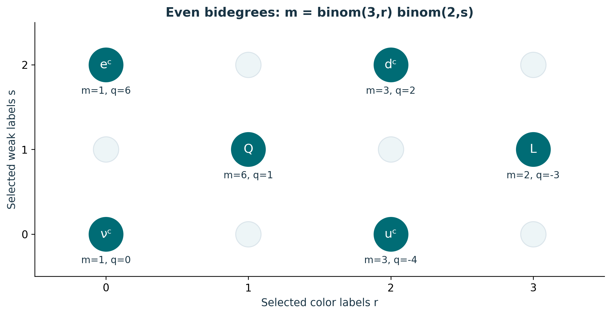
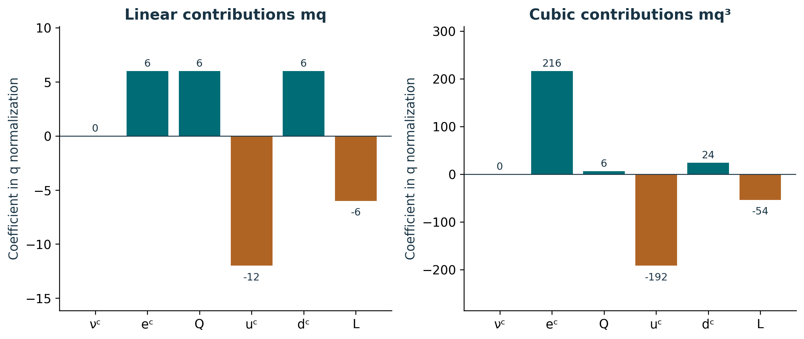
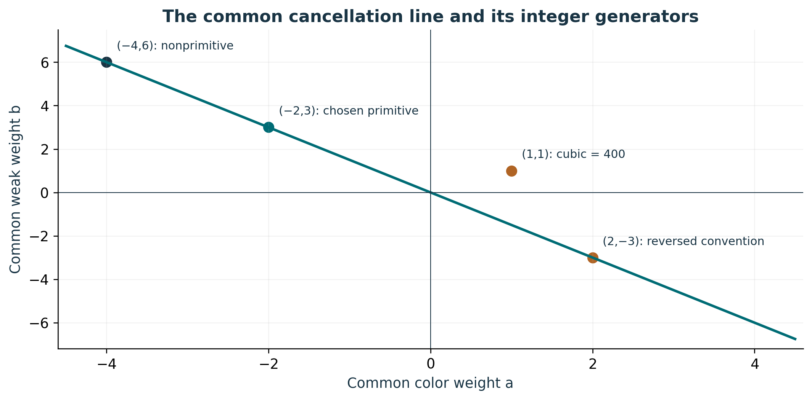

# Publication visual companion

These newly prepared teaching figures accompany the preserved lessons. Numerical examples are synthetic and dimensionless unless explicitly stated. They illustrate finite constructions and retain the specified evidence scope.

## Six bidegrees account for sixteen states

Filled positions have r+s even; pale positions belong to the complementary odd sector. Multiplicities (1,1,6,3,3,2) sum to 16. Charges follow q=−2r+3s, and Y=q/6. Each marker groups distinct canonical wedge products; its multiplicity remains part of the census. Wedge reordering signs alter coefficients, not these basis charges. Source: S02 /backbone_sequence/10/sector_census.

**Lesson mapping:** [Lesson 01](lesson-01.md); [Lesson 02](lesson-02.md); [Lesson 03](lesson-03.md).

# Cancellation retains the signed contributions

The two panels sum to zero independently: 6+6−12+6−6=0 and 216+6−192+24−54=0. Cubing occurs before multiplying by multiplicity. These are two of five separately named tests. The synthetic off-line trial (a,b)=(1,0) retains residual vector (24,108,3,3,0) in the order linear, cubic, color mixed, weak mixed, pure color. A zero total does not replace its component ledger. Source: S02 /proof_nodes/68/formula.

**Lesson mapping:** [Lesson 04](lesson-04.md); [Lesson 07](lesson-07.md).

# A line of solutions, then a sign convention

The cubic factors as (3a+2b)(36a²+24ab+20b²). Its quadratic factor equals 36(a+b/3)²+16b² and is positive away from (0,0). Thus nonzero cancellation lies on 3a+2b=0. Integer solutions are (−2k,3k); primitivity requires |k|=1. Choosing color negative and weak positive selects k=1 by the declared convention. This is conditional on the retained matter inventory and supplied test weights. Source: S02 /proof_nodes/69/formula.

**Lesson mapping:** [Lesson 05](lesson-05.md); [Lesson 06](lesson-06.md).
