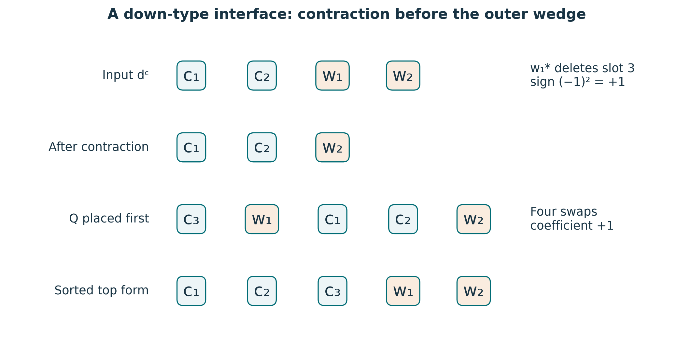
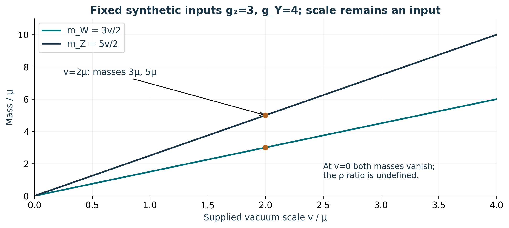
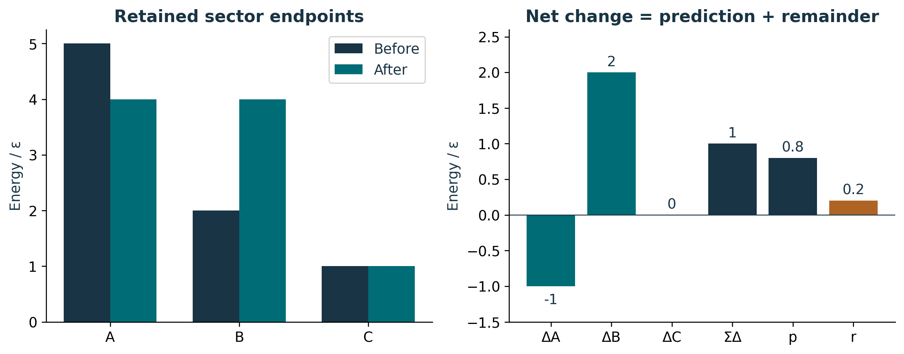

# Publication visual companion

These newly prepared teaching figures accompany the preserved lessons. Numerical examples are synthetic and dimensionless unless explicitly stated. They illustrate finite constructions and retain the specified evidence scope.

## Slot order determines the interface sign

Use the declared color-first top form Ω=c₁∧c₂∧c₃∧w₁∧w₂. The weak covector w₁* deletes position 3 from dᶜ=c₁∧c₂∧w₁∧w₂, leaving +c₁∧c₂∧w₂. In I_d, Q=c₃∧w₁ is placed FIRST. Sorting Q∧ι_barH dᶜ takes four exchanges, so Ω⁻¹ extracts +1. The charge check is 1−3+2=0. A scalar contraction value is not a fitted interaction strength; the ordered inputs and covector action remain necessary. Source: S02 /backbone_sequence/11 and /proof_nodes/84/formula.

**Lesson mapping:** [Lesson 01](lesson-01.md); [Lesson 02](lesson-02.md); [Lesson 03](lesson-03.md).

# Neutrality does not select the mass scale

For the declared neutral vacuum (0,v/√2), Q_electric=diag(1,0) annihilates it for every v. The supplied mass formulas give these two straight lines for nonnegative v, with cos²θ=9/25. Where v>0, m_W²/(m_Z² cos²θ)=1; at v=0 it is 0/0 and is not assigned a value. These are synthetic algebraic evaluations, not measured masses or a derivation of v. The potential, couplings, Yukawa matrices and matching choices remain specified inputs. Source: S02 /proof_nodes/80/formula.

**Lesson mapping:** [Lesson 03](lesson-03.md); [Lesson 04](lesson-04.md); [Lesson 05](lesson-05.md).

# Retain endpoints, signed changes, and the remainder

The synthetic endpoint sums change from 8ε to 9ε. Signed changes (−1,+2,0)ε total +1ε. With the supplied prediction p=0.8ε, r=ΣΔ−p=0.2ε, and p+r recovers the net change. This model remainder differs from a balance remainder b=ΔE−T, which requires an independently specified external transfer T. No transfer or elapsed time is supplied here, so this panel does not invent a closed-system balance or power. Source connection: Lessons 6–7 distinguish the action interface from the energy ledger.

**Lesson mapping:** [Lesson 06](lesson-06.md); [Lesson 07](lesson-07.md).
