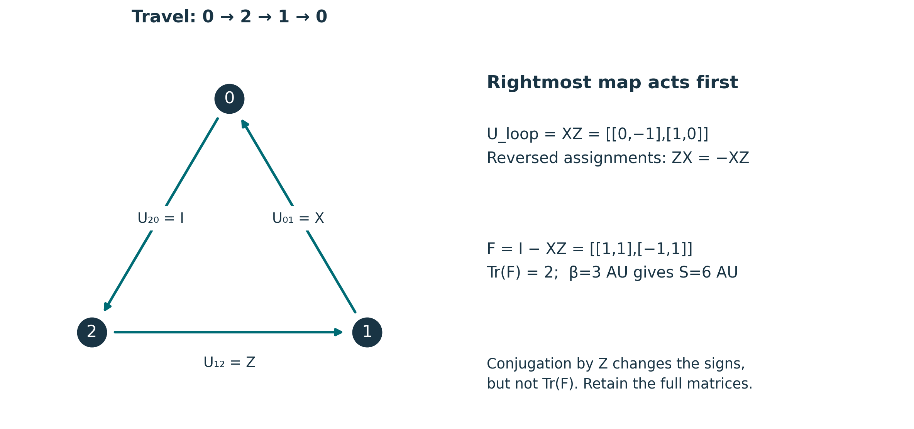
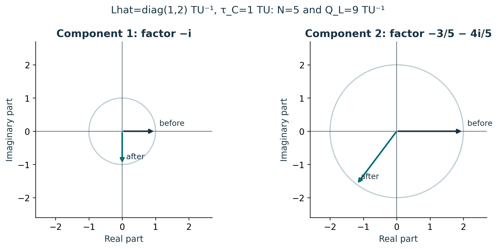
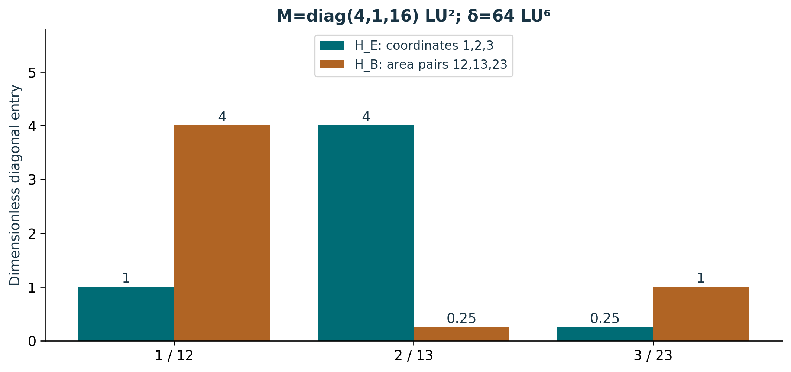

# Publication visual companion

These newly prepared teaching figures accompany the preserved lessons. Numerical examples are synthetic and dimensionless unless explicitly stated. They illustrate finite constructions and retain the specified evidence scope.

## Direction and order survive the invariant summary

The subscript U_xy means y→x, so U₀₁U₁₂U₂₀ is based at 0 and follows 0→2→1→0. With X swapping components and Z=diag(1,−1), XZ and ZX are different. A frame change gives G₀U_loopG₀⁻¹, not an arbitrary exchange of factors. Their trace action agrees while their off-diagonal information remains distinct. Keep links, basepoint, path, F, β and S. Source: S02 /backbone_sequence/12/definitions; all pictured matrices are synthetic.

**Lesson mapping:** [Lesson 01](lesson-01.md); [Lesson 02](lesson-02.md); [Lesson 03](lesson-03.md); [Lesson 04](lesson-04.md).

# Conserved sizes still permit a structured state change

The Cayley map sends (1,2) to (−i,−6/5−8i/5); its adjoint recovers the input. The circles show unchanged component squared sizes 1 and 4, giving N=5 and Q_L=9 TU⁻¹. The normalized expectation is Q_L/N=9/5 TU⁻¹. Against the initial reference the complete remainder is (−1−i,−16/5−8i/5), not zero. The finite proof requires a self-adjoint Lhat, real τ_C and an invertible denominator. It does not establish a continuum comparison. Source: S02 /backbone_sequence/12.

**Lesson mapping:** [Lesson 05](lesson-05.md); [Lesson 08](lesson-08.md).

# Normalization preserves shape while scale stays in the record

The mature formulas H_E=δ^(1/3)R and H_B=δ^(2/3)wedge²R give the shown entries; each determinant is 1. In pair order (12,13,23), J exchanges the outer coordinates and negates the middle, giving JH_BJᵀ=diag(1,1/4,4)=H_E⁻¹. Scaling M by 4 leaves both normalized blocks unchanged, so retain M and its scale separately. This declared synthetic J does not replace an unavailable archival convention. Historical exponents 2/3 and 4/3 instead give determinants 64 and 4096 in fixed LU units. Source: S02 /hodge_normalization_theorem; S03 /findings/8 retains the replay gap.

**Lesson mapping:** [Lesson 06](lesson-06.md); [Lesson 07](lesson-07.md).
