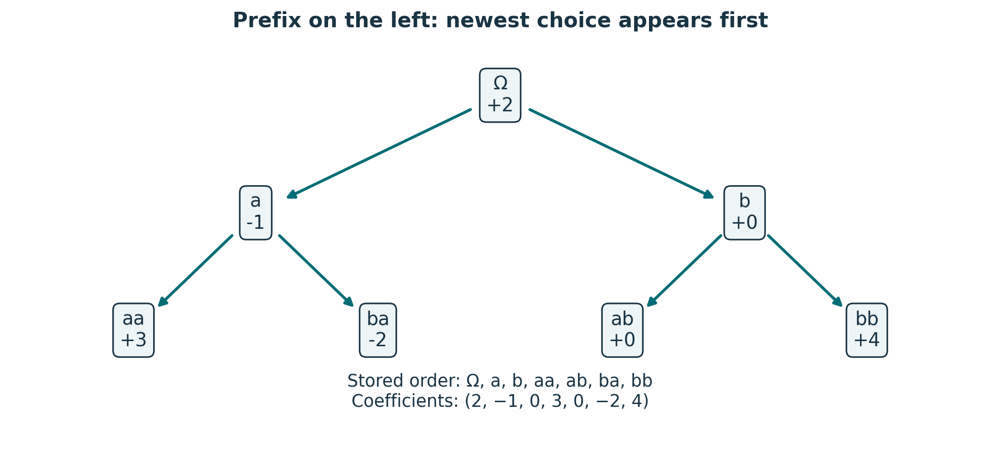
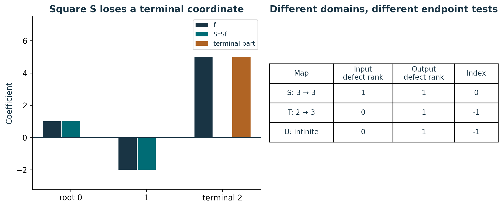
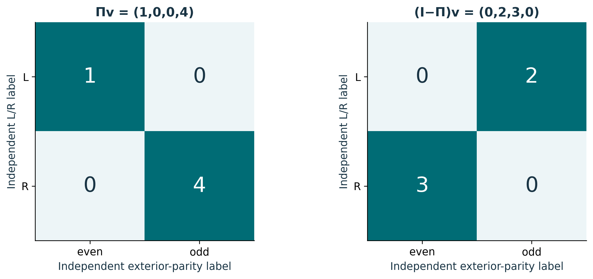

# Publication visual companion

These newly prepared teaching figures accompany the preserved lessons. Numerical examples are synthetic and dimensionless unless explicitly stated. They illustrate finite constructions and retain the specified evidence scope.

## An empty word is an address, not a zero value

Each arrow adds a letter on the left: a→ba prefixes b, while b→ab prefixes a. The displayed tree retains all seven addresses and all signed coefficients, including zero values at b and ab. Removing a from a returns the root address; removing a from ba returns the zero vector, not the root vector. A depth cutoff needs an additional rule for outputs beyond the drawing. This binary tree is the Lesson 1 synthetic example, not the source eight-letter infinite carrier. Source context: S02 /backbone_sequence/13.

**Lesson mapping:** [Lesson 01](lesson-01.md); [Lesson 02](lesson-02.md).

# Both endpoint defects belong in the record

For f=(1,−2,5), Sf=(0,1,−2) and S†Sf=(1,−2,0). The retained terminal vector (0,0,5) restores f, and squared norms satisfy 30=5+25. S has a lost input and an unreachable root output, hence index 1−1=0. T(a,b)=(0,a,b) has no terminal input slot, while the explicitly defined infinite U has no last slot. Their index −1 does not identify either with the source radial T₀. The source replay gap remains S03 /findings/8.

**Lesson mapping:** [Lesson 02](lesson-02.md); [Lesson 03](lesson-03.md); [Lesson 04](lesson-04.md).

# Correlating two labels does not identify them

In the order (L,even),(L,odd),(R,even),(R,odd), Π=diag(1,0,0,1). Both panels sum to v=(1,2,3,4); squared norms 17+13=30 retain the complete record. The unselected pairs still exist. Spatial handedness, time orientation, L/R labels, exterior parity and spin are separately defined fields. This verifies finite selector algebra, not a recovered Clifford realization or physical selection proof. Source context: S02 /backbone_sequence/13/correlated_projector and the Lesson 7 premise ledger.

**Lesson mapping:** [Lesson 05](lesson-05.md); [Lesson 06](lesson-06.md); [Lesson 07](lesson-07.md).
