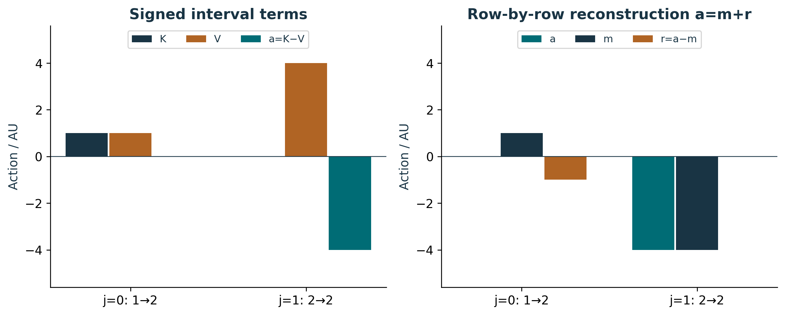
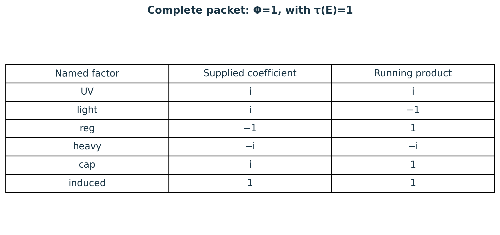
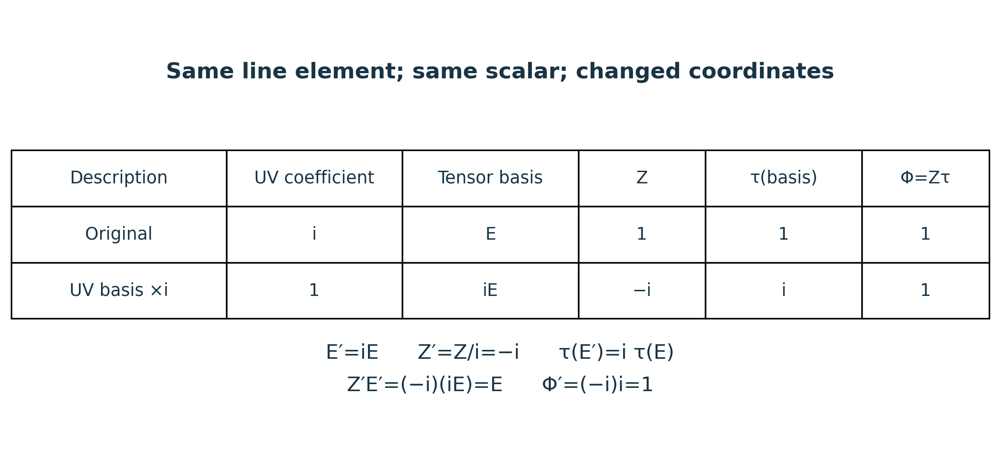

# Publication visual companion

These newly prepared teaching figures accompany the preserved lessons. Numerical examples are synthetic and dimensionless unless explicitly stated. They illustrate finite constructions and retain the specified evidence scope.

## Zero and negative contributions retain their components

For q=(1,2,2), Δt=1 TU, k=2 AU·TU and vpot=2 AU/TU, the left-endpoint rule gives K=(1,0), V=(1,4) and a=(0,−4) AU. The first zero is a cancellation of two nonzero terms. Against m=(1,−4) AU, r=(−1,0) AU reconstructs every row and S=−4 AU. The action total is not a measured energy or a probability. The ordered path, boundary conditions and evaluation convention remain inputs. Source context: the separate M15 action card at S02 /backbone_sequence/14/action; these numbers follow the authored finite rule.

**Lesson mapping:** [Lesson 01](lesson-01.md); [Lesson 02](lesson-02.md); [Lesson 07](lesson-07.md).

# A unit factor is known, not missing

Keep all six factors in the declared order. Deleting heavy=−i changes the product from 1 to i; its retained closure remainder is i−1. Deleting induced=1 would leave the number unchanged but lose a supplied contribution. In the separately declared two-sector example, changing the final coefficient to −1 yields Φ_b=−1 and remainder −2. That admitted sector remains in the domain even though it fails closure. Source: S02 /backbone_sequence/14/determinant_line; the values and sector list are synthetic.

**Lesson mapping:** [Lesson 03](lesson-03.md); [Lesson 04](lesson-04.md); [Lesson 06](lesson-06.md).

# Rebasing transports the reading rule as well as coefficients

Only the UV basis changes; its new coefficient is i/i=1. The new six-factor product is Z′=−i, but the same linear map τ reads the new tensor basis as i. Keeping τ(E′)=1 would incorrectly report −i. Retaining the basis multiplier, full coefficient list and both τ values makes the description reversible. This local calculation does not supply a global trivialization or the full source sector domain. Source: S02 /backbone_sequence/14/determinant_line.

**Lesson mapping:** [Lesson 04](lesson-04.md); [Lesson 05](lesson-05.md); [Lesson 07](lesson-07.md).
