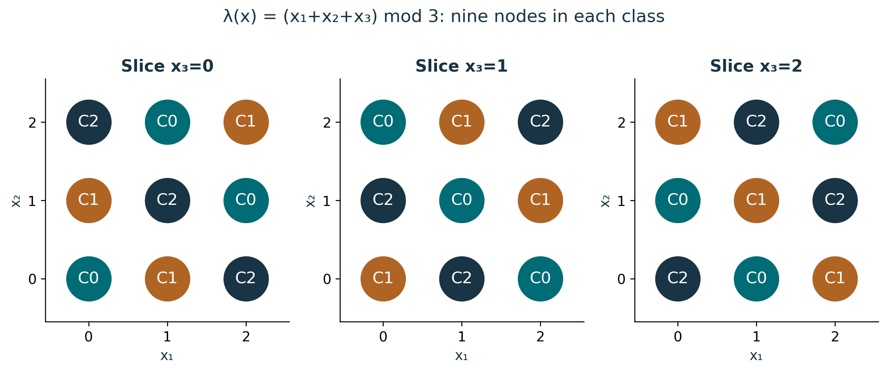
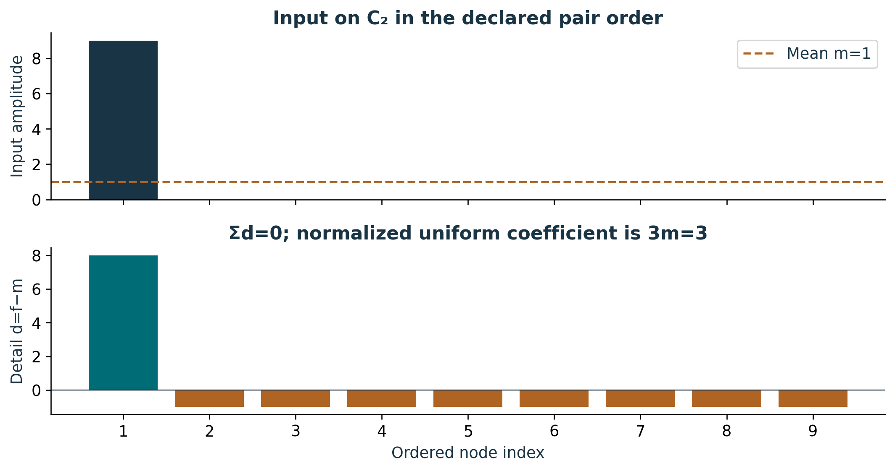
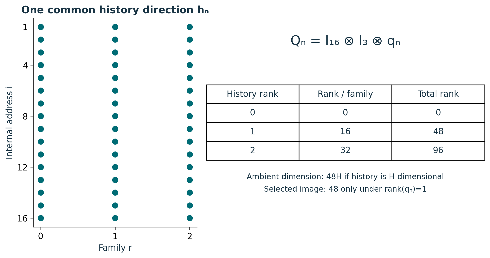
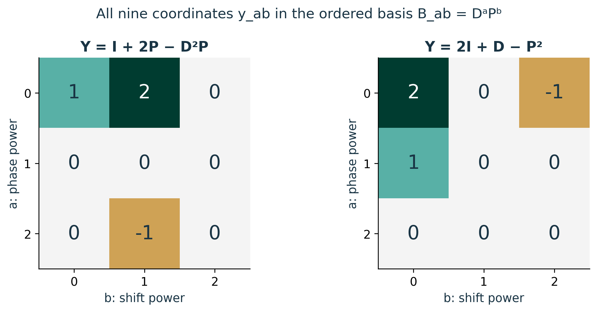

# Publication visual companion

These newly prepared teaching figures accompany the preserved lessons. Numerical examples are synthetic and dimensionless unless explicitly stated. They illustrate finite constructions and retain the specified evidence scope.

## All twenty-seven labels remain visible

Each dot is the triple (x₁,x₂,x₃) fixed by its axes and slice. The three colors label residues 0,1,2; for any first-coordinate pair and chosen residue, x₃ is uniquely determined modulo 3. Each class therefore has nine nodes. These are finite addresses, not measured particle locations. The class labels do not become detector parity, chirality or occupied physical states merely by sharing a count. Source: S02 /backbone_sequence/15/definitions.

**Lesson mapping:** [Lesson 01](lesson-01.md); [Lesson 02](lesson-02.md).

# The normalized coefficient is not the mean

The input (9,0,0,0,0,0,0,0,0) has mean 1 and detail (8,−1,−1,−1,−1,−1,−1,−1,−1). Because Φ₂ has amplitude 1/3 at each of nine nodes, the uniform component is 3Φ₂, not Φ₂. Adding the two components recovers every entry; squared norms satisfy 81=9+72. Across all three classes there are three uniform coordinates and 3×8 independent detail coordinates, totaling 27. Keep the ninth dependent detail and all zero entries in the displayed ledger. Source: S02 /backbone_sequence/15/definitions.

**Lesson mapping:** [Lesson 02](lesson-02.md); [Lesson 03](lesson-03.md).

# Forty-eight counts a specified image basis

Each dot denotes one independent e_i⊗f_r⊗h_n. There are 16 per family and 48 in total when q_n is nonzero, orthogonal and rank one. The history counts (1,1,1) are not three whole-family ranks of one. A zero or rank-two history factor changes the count as shown. Preserve Q_n x and (I−Q_n)x to reconstruct a state. Source F038 occupation, D10 guard and AUD-007 selection-proof recovery remain distinct records; the conditional count does not resolve their documentary conflict. Source: S02 /backbone_sequence/15/family_projector and /proof_nodes/78; S03 /findings/6.

**Lesson mapping:** [Lesson 04](lesson-04.md); [Lesson 05](lesson-05.md); [Lesson 06](lesson-06.md).

# A complete basis represents an input; it does not select it

The full 3×3 tables retain every coefficient, including six zeros in each example. The trace rule y_ab=Tr(B_ab†Y)/3 extracts them and Σ y_ab B_ab reconstructs the supplied Y. Since DP=ωPD, reversing factor order would require transporting the coefficients too. These are dimensionless synthetic matrices, not physical Yukawa values. The same preservation principle governs Lesson 7: after Schur elimination, retain the reconstructed second variable and both original-equation residuals, including singular and incompatible branches. Source: S02 /backbone_sequence/15/weyl_basis and /schur_interface.

**Lesson mapping:** [Lesson 03](lesson-03.md); [Lesson 07](lesson-07.md).
