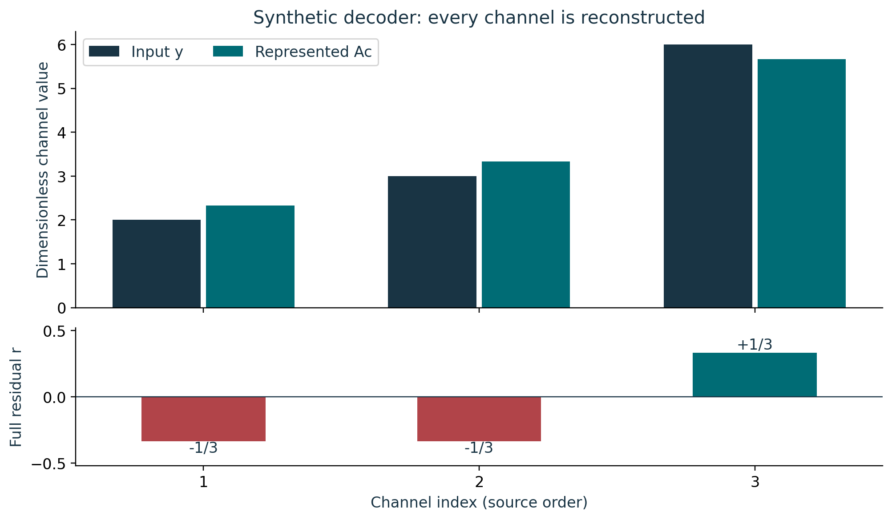
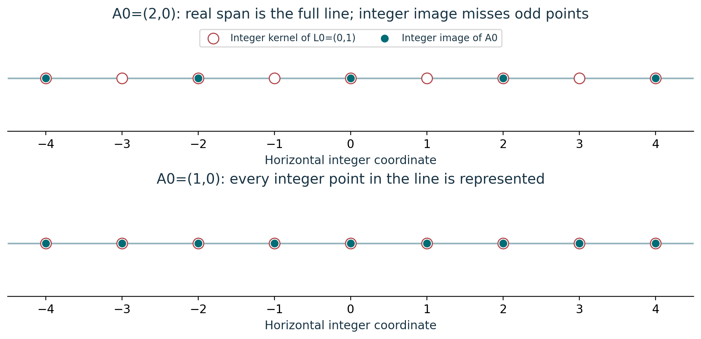
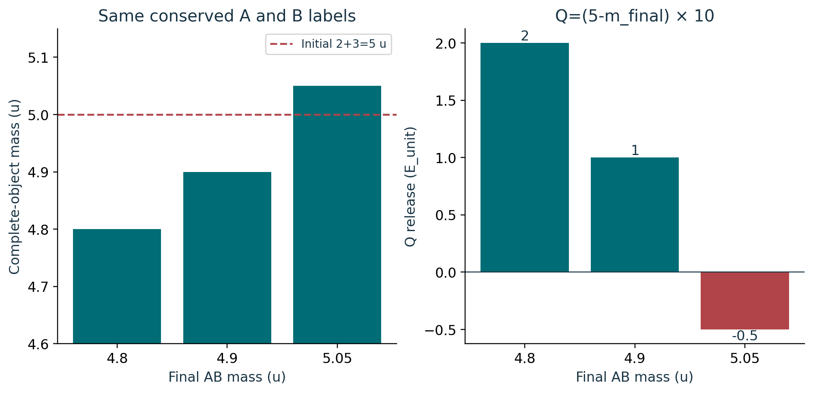
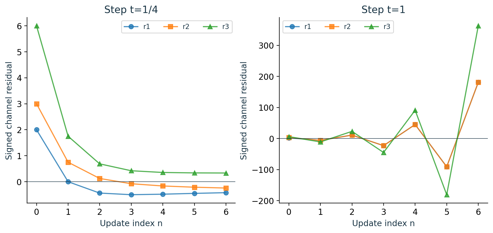

# Course 21: publication visual companion

These publication-added teaching figures accompany the preserved lessons. Numerical illustrations are synthetic unless a caption explicitly identifies a source-defined mathematical object. Plot coordinates are derived from the stated inputs; exact values and source scope remain in the linked lessons.

## Figure 21.1: Channel reconstruction

Read the lower panel entry by entry: y=Ac+r. Both column sums of the residual vanish, since -1/3+1/3=0, while the residual itself remains nonzero. Its basis is (-1,-1,1), with syndrome coordinate t=1/3. A squared length alone cannot reproduce the signs and channel order.

Lesson connection: [1](lesson-01.md), [2](lesson-02.md), [8](lesson-08.md). Consult those lessons and [source provenance](sources.md) for exact source addresses and evidence classes.

## Figure 21.2: Lattice saturation

Both examples have one real image direction and satisfy L0 A0=0. The open odd points in the upper panel explain why a rank count cannot establish equality over the integers. Lesson-03 proves saturation of its specific 13-by-6 matrix by an explicit integer extractor; this diagram does not supply the missing source L.

Lesson connection: [2](lesson-02.md), [3](lesson-03.md). Consult those lessons and [source provenance](sources.md) for exact source addresses and evidence classes.

## Figure 21.3: Signed endpoint energy

Changing only the final complete-object mass changes the signed endpoint difference. The 5.05 u branch requires 0.5 E_unit of input. All masses use the same constituent, charge and reference-state convention. A positive energy difference supplies neither a duration nor a recovered fraction; those inputs are needed separately for mean power.

Lesson connection: [5](lesson-05.md), [6](lesson-06.md). Consult those lessons and [source provenance](sources.md) for exact source addresses and evidence classes.

## Figure 21.4: Solver residual history

At t=1/4 the coefficient error contracts, but the channel residual tends to (-1/3,-1/3,1/3). At t=1 the sum-direction multiplier is -2, producing alternating growth. Every point still obeys y=A_small c_n+r_n. The extra plotted steps are deterministic teaching calculations, not observations.

Lesson connection: [7](lesson-07.md), [8](lesson-08.md). Consult those lessons and [source provenance](sources.md) for exact source addresses and evidence classes.
