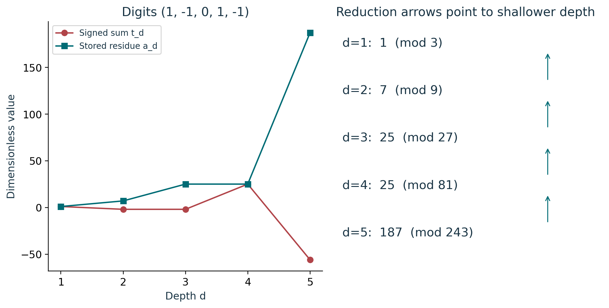
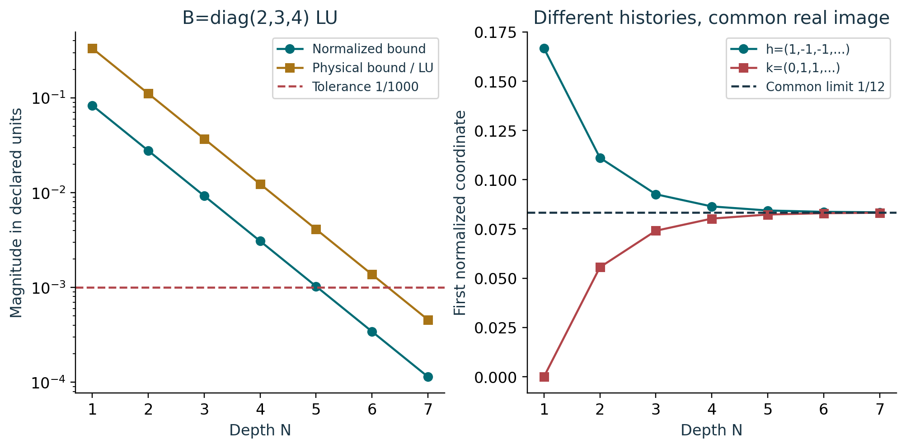
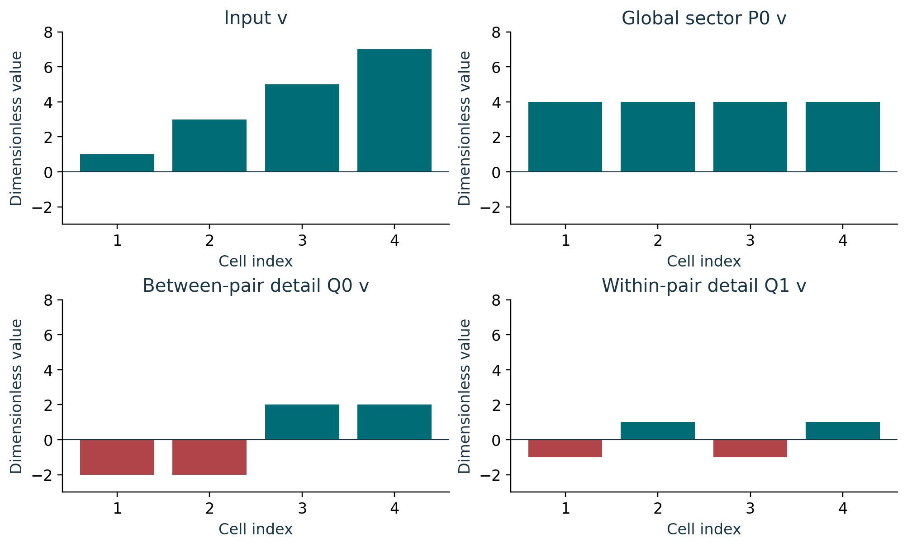

# Course 22: publication visual companion

These publication-added teaching figures accompany the preserved lessons. Numerical illustrations are synthetic unless a caption explicitly identifies a source-defined mathematical object. Plot coordinates are derived from the stated inputs; exact values and source scope remain in the linked lessons.

## Figure 22.1: Compatible address ladder

At depth 2, signed -2 is stored as residue 7 modulo 9. At depth 3, the same signed -2 becomes residue 25 modulo 27. Both records are needed with their depth. The arrows encode 187 mod 81=25, 25 mod 27=25, 25 mod 9=7, and 7 mod 3=1. The first-coordinate example extends to triples by retaining two zero coordinates.

Lesson connection: [1](lesson-01.md), [2](lesson-02.md), [3](lesson-03.md). Consult those lessons and [source provenance](sources.md) for exact source addresses and evidence classes.

## Figure 22.2: Renderer tail and history

The uniform normalized tail is 1/(4 times 3^N), reaching tolerance 1/1000 at N=6. Multiplication by the synthetic matrix norm 4 LU gives the physical bound, requiring N=7. In the right panel h and k approach the same 1/12 from opposite sides, although their first residues differ. Retain the history together with its image and signed tail.

Lesson connection: [2](lesson-02.md), [4](lesson-04.md). Consult those lessons and [source provenance](sources.md) for exact source addresses and evidence classes.

## Figure 22.3: Retained detail sectors

Add P0 v, Q0 v and Q1 v entry by entry to recover v=(1,3,5,7). The signed detail vectors have zero sum, yet neither vanishes. P0, Q0 and Q1 are disjoint orthogonal sectors; the pairwise averaging operator P1=P0+Q0 overlaps P0. This finite binary grouping does not redefine ternary address depth.

Lesson connection: [5](lesson-05.md), [6](lesson-06.md). Consult those lessons and [source provenance](sources.md) for exact source addresses and evidence classes.
