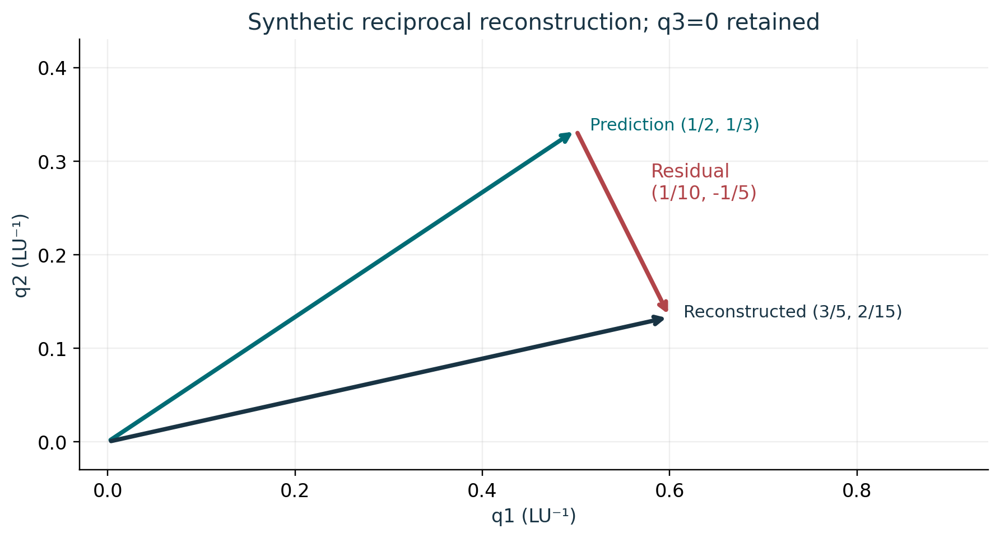
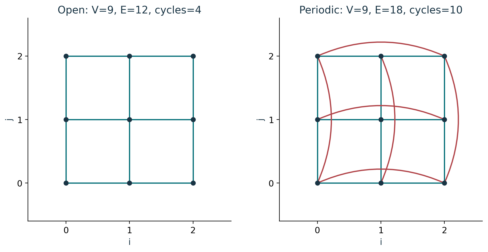
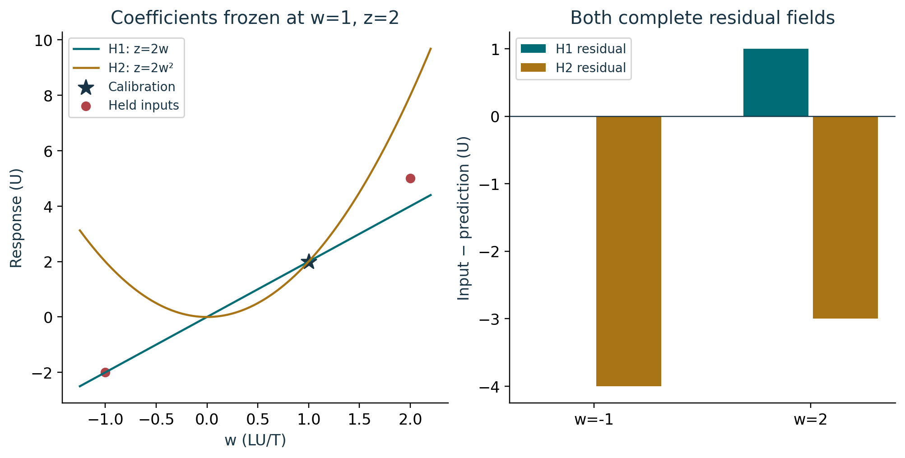

# Course 23: publication visual companion

These publication-added teaching figures accompany the preserved lessons. Numerical illustrations are synthetic unless a caption explicitly identifies a source-defined mathematical object. Plot coordinates are derived from the stated inputs; exact values and source scope remain in the linked lessons.

## Figure 23.1: Reciprocal residual vector

The red arrow starts at the prediction and ends at the reconstructed reciprocal vector. Spacing and unit normal must be calculated from the endpoint vector: its squared length is 17/45 LU^-2. A scalar residual length would not identify this endpoint. The third coordinate stays explicitly zero.

Lesson connection: [2](lesson-02.md), [7](lesson-07.md). Consult those lessons and [source provenance](sources.md) for exact source addresses and evidence classes.

## Figure 23.2: Open and periodic cycles

A spanning tree has eight edges on these nine vertices. Subtracting eight from the edge count gives four independent open cycles or ten periodic cycles. The extra six edges add six independent cycles. The three-dimensional source counts are 27 vertices with 54 or 81 edges; neither count constructs an exceptional-algebra action.

Lesson connection: [4](lesson-04.md), [5](lesson-05.md). Consult those lessons and [source provenance](sources.md) for exact source addresses and evidence classes.

## Figure 23.3: Frozen response comparison

H1 reverses sign under w to -w; H2 remains unchanged. The residuals (0,1) U and (-4,-3) U preserve each model’s difference from the same held cases. Neither is erased or replaced by a score. A future orientation test must freeze the model before collecting its output.

Lesson connection: [3](lesson-03.md), [6](lesson-06.md), [7](lesson-07.md). Consult those lessons and [source provenance](sources.md) for exact source addresses and evidence classes.
