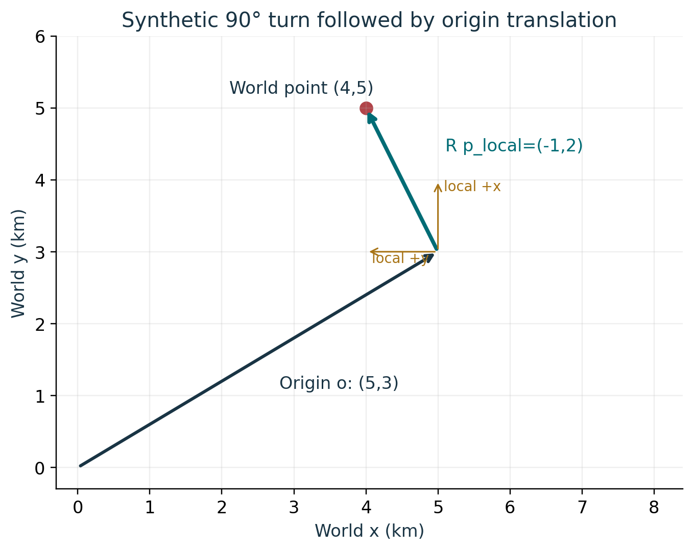
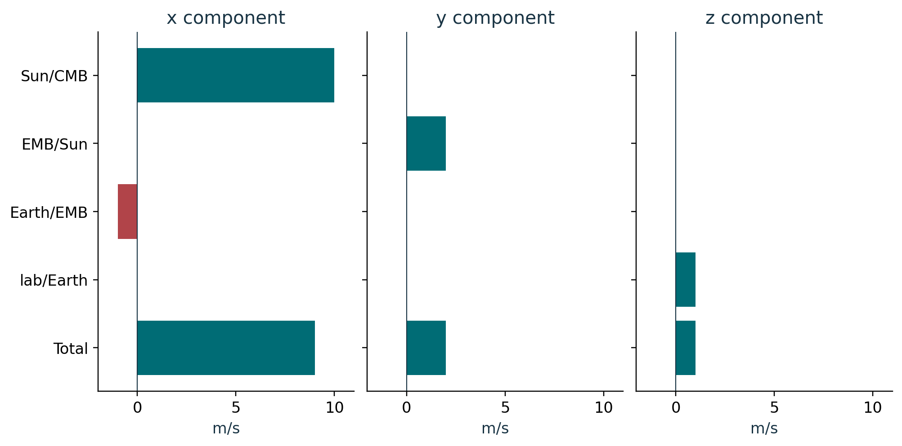
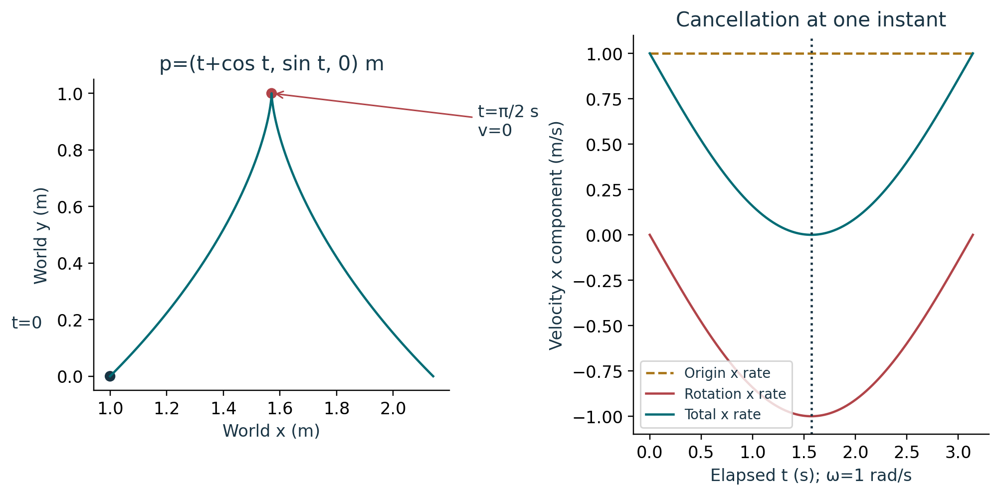

# Course 24: publication visual companion

These publication-added teaching figures accompany the preserved lessons. Numerical illustrations are synthetic unless a caption explicitly identifies a source-defined mathematical object. Plot coordinates are derived from the stated inputs; exact values and source scope remain in the linked lessons.

## Figure 24.1: Turn then translate

The local point (2,1,0) km contributes twice the carried x axis plus once the carried y axis. After the quarter-turn that offset is (-1,2,0) km. Add origin (5,3,1) km to obtain (4,5,1) km; reverse by subtracting the origin before applying R transpose.

Lesson connection: [1](lesson-01.md), [2](lesson-02.md). Consult those lessons and [source provenance](sources.md) for exact source addresses and evidence classes.

## Figure 24.2: Nested velocity ledger

Summing each column gives (9,2,1) m/s. Over two seconds the four displacements are (20,0,0), (0,4,0), (-2,0,0), and (0,0,2) m. With initial (1,2,3) m the endpoint is (19,6,5) m. The real source Earth/CMB vector is already composed and is not an additional independent term.

Lesson connection: [3](lesson-03.md), [7](lesson-07.md). Consult those lessons and [source provenance](sources.md) for exact source addresses and evidence classes.

## Figure 24.3: Moving origin and turning axes

At t=π/2 s the origin and rotation velocities are (1,0,0) and (-1,0,0) m/s, giving zero total velocity. Acceleration there is still (0,-1,0) m/s². A zero instantaneous total therefore retains two nonzero causes and does not describe the whole interval as stationary.

Lesson connection: [4](lesson-04.md), [5](lesson-05.md). Consult those lessons and [source provenance](sources.md) for exact source addresses and evidence classes.
