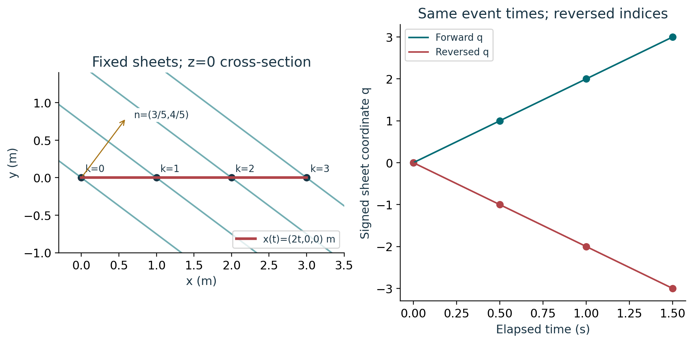
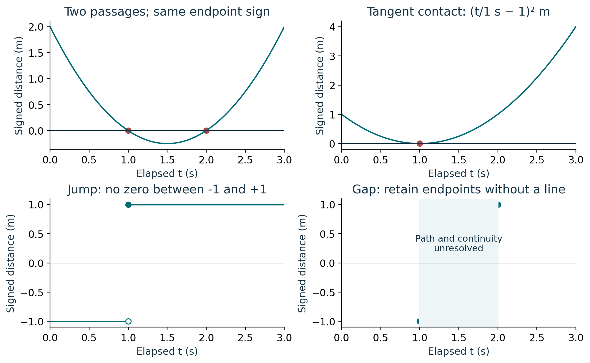
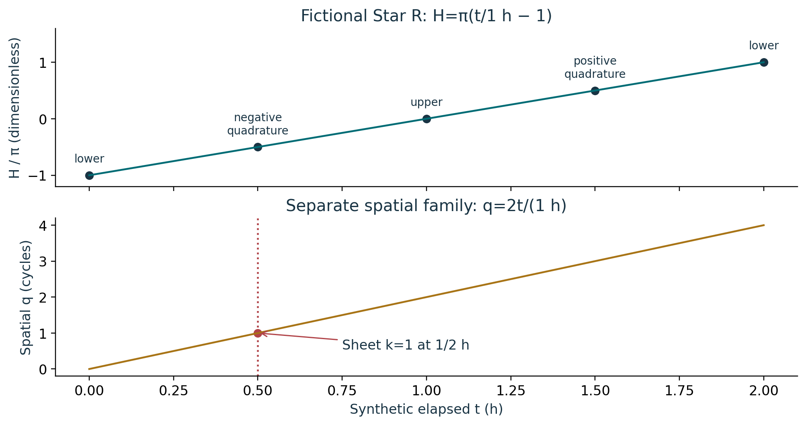

# Course 25: publication visual companion

These publication-added teaching figures accompany the preserved lessons. Numerical illustrations are synthetic unless a caption explicitly identifies a source-defined mathematical object. Plot coordinates are derived from the stated inputs; exact values and source scope remain in the linked lessons.

## Figure 25.1: Signed plane passages

The plotted lines satisfy (3/5)x+(4/5)y=k(3/5). Along the x axis q=x/(1 m)=2t/(1 s). Reversal keeps the positive period 1/2 s while changing q and sheet indices to their negatives. The declared family polarity is a separate field and does not follow from this reversal.

Lesson connection: [1](lesson-01.md), [2](lesson-02.md), [3](lesson-03.md), [7](lesson-07.md). Consult those lessons and [source provenance](sources.md) for exact source addresses and evidence classes.

## Figure 25.2: Event types and gaps

For the quadratic (t/1 s-1)(t/1 s-2) m, both outer endpoints are positive despite two passages. The square touches zero without sign reversal. The jump never equals zero. Unknown continuity across the gap leaves root existence, count and times unresolved; no interpolated event is inserted.

Lesson connection: [5](lesson-05.md), [7](lesson-07.md). Consult those lessons and [source provenance](sources.md) for exact source addresses and evidence classes.

## Figure 25.3: Angular and spatial event equations

The upper panel uses hour angle, while the lower uses a length projection divided by spacing. Their common time does not make the equations interchangeable. The lower meridian events at 0 and 2 h have different unwrapped branches, H=-π and +π. These are fictional clocks, not UTC celestial predictions.

Lesson connection: [6](lesson-06.md), [7](lesson-07.md). Consult those lessons and [source provenance](sources.md) for exact source addresses and evidence classes.
