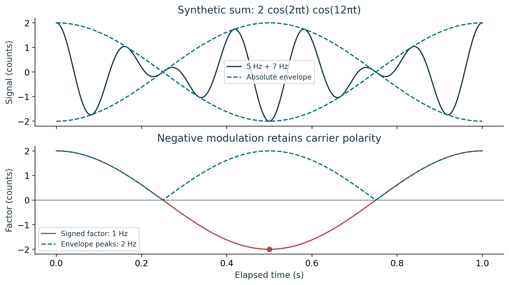
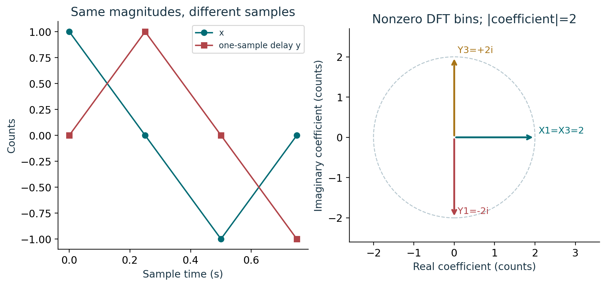
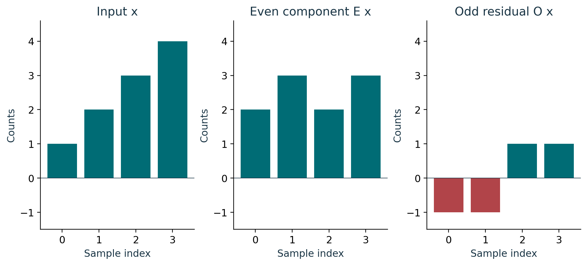
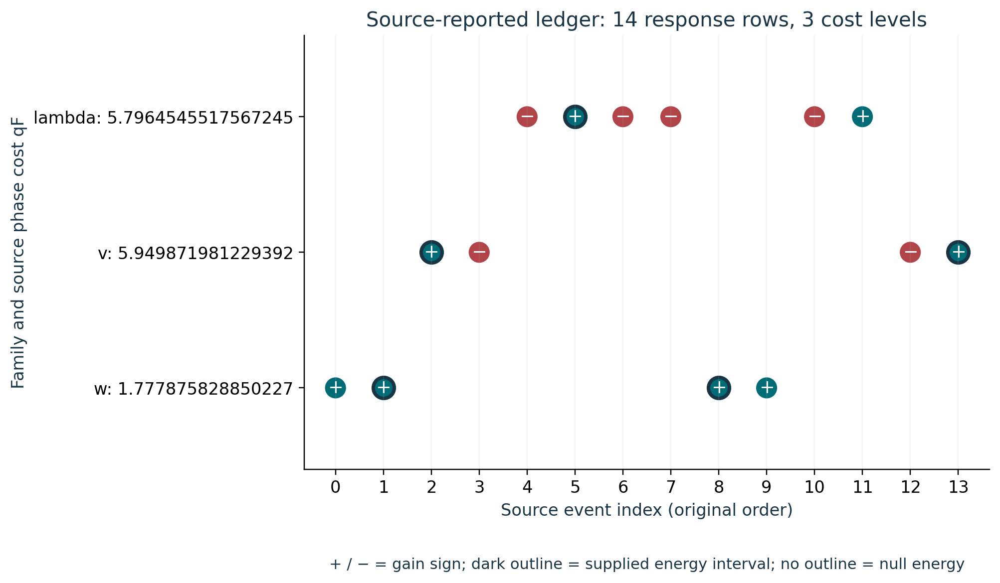

# Course 26: publication visual companion

These publication-added teaching figures accompany the preserved lessons. Numerical illustrations are synthetic unless a caption explicitly identifies a source-defined mathematical object. Plot coordinates are derived from the stated inputs; exact values and source scope remain in the linked lessons.

## Figure 26.1: Signed beat envelope

At t=1/2 s the carrier is +1 but the signed factor is -2 counts, so the sum is -2 counts. Replacing the factor by the nonnegative envelope changes that sample to +2. The bound and the signed modulation therefore have different reconstruction roles.

Lesson connection: [1](lesson-01.md), [2](lesson-02.md). Consult those lessons and [source provenance](sources.md) for exact source addresses and evidence classes.

## Figure 26.2: Delay preserves magnitude changes phase

The delayed sequence rotates bin 1 from +2 to -2i and bin 3 from +2 to +2i. All shown vectors have magnitude 2, so a magnitude-only spectrum cannot distinguish the two sequences. Retain the complex coefficients, sample interval 1/4 s, time origin and inverse normalization.

Lesson connection: [4](lesson-04.md), [5](lesson-05.md). Consult those lessons and [source provenance](sources.md) for exact source addresses and evidence classes.

## Figure 26.3: Even comparison retains odd residual

The sum E x+O x returns every input entry. An even comparator is blind to the odd residual because the two half-turn contributions cancel. The residual DFT is (0,-2+2i,0,-2-2i), carrying bins unavailable to the even sector. Comparator blindness does not remove those input coordinates.

Lesson connection: [5](lesson-05.md), [8](lesson-08.md). Consult those lessons and [source provenance](sources.md) for exact source addresses and evidence classes.

## Figure 26.4: All row source cost map

All fourteen rows remain in original index order. Four w rows, four v rows and six lambda rows use three cost inputs. Eight signs are positive and six negative; only five positive rows have energy intervals. The three other positive rows have null energy, which remains distinct from zero. Exact original counts, uncertainties and revision obligations remain in the lesson and its immutable source references.

Lesson connection: [6](lesson-06.md), [7](lesson-07.md), [8](lesson-08.md). Consult those lessons and [source provenance](sources.md) for exact source addresses and evidence classes.
