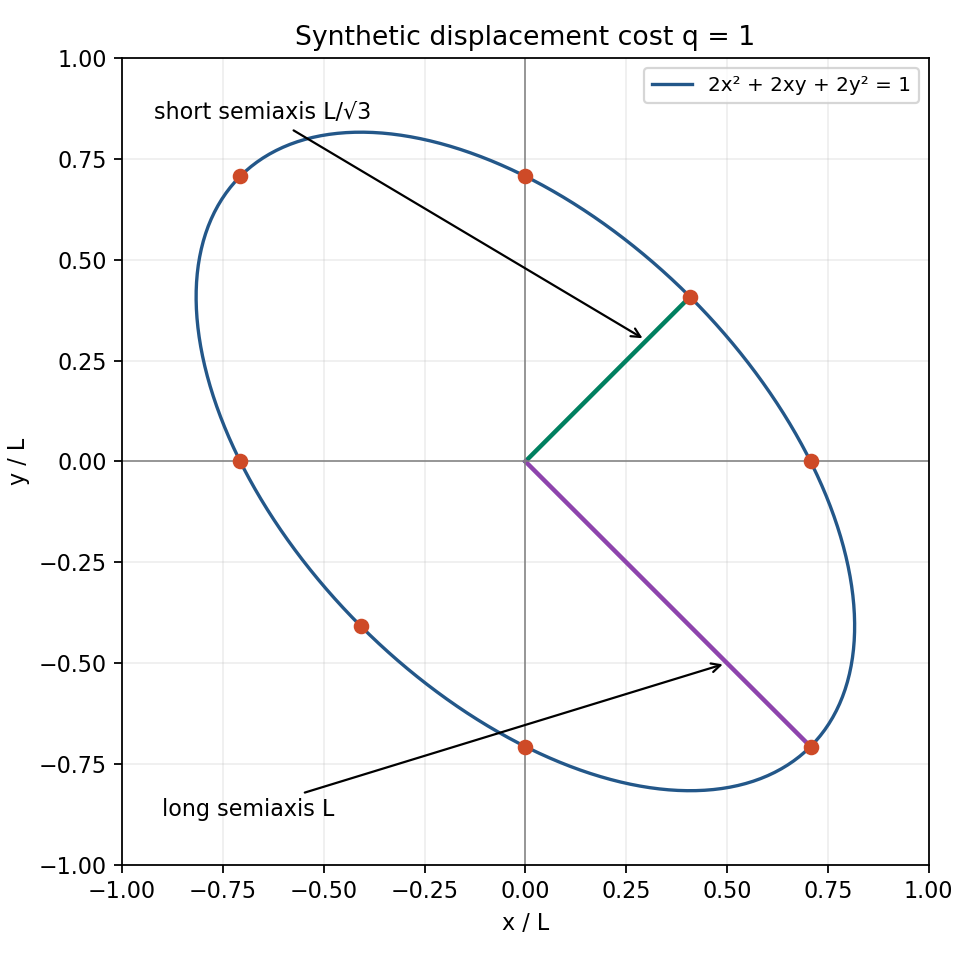

# Quadratic Phase Cost and Route Geometry

Seven lessons; source notes, teacher guide and capstone are companion files.

<!-- BEGIN: lesson-01 -->
# Lesson 1 — A quadratic form as a directional cost

**Essential question:** How can equal-length moves have different costs?

**Goals:** Evaluate a two-coordinate quadratic form; explain its cross term and positivity; plot a constant-cost contour with correct units.

**Prerequisite bridge.** You need signed arithmetic, squares and coordinate graphs. A vector is an ordered list of components: (1,2) means one step along the first axis and two along the second. Its squared length is 1²+2²=5. A square root reverses squaring for nonnegative numbers, so its length is √5. We will teach the matrix notation here, even if you met it in courses 10 or 17. No calculus is required. Use L for one chosen length unit and τ for one chosen time unit throughout the synthetic examples; L and τ are units, not changing variables.

Two 55-minute sessions: first evaluate forms, then draw their contours. Each session uses 5 minutes retrieval, 20 explanation/example, 15 practice and 15 diagnostics/repair.

## C27.01-E1 — Build the form from arithmetic

A matrix is a rectangular table of numbers. A column vector lists components vertically. Multiplication of a matrix by a column means taking each row, multiplying matching entries, and adding. With our **synthetic** matrix

G = [[2,1],[1,2]] L⁻²,

the product G(x,y) has components (2x+y, x+2y), with the units carried separately. The superscript T means transpose: a column becomes a row. Therefore the scalar (one-number) expression zᵀGz means multiply G by z and then take matching products with z and add. In numerical coordinates,

q(z)=2x²+2xy+2y².

The cross term is 2xy because the upper-right entry gives xy and the lower-left entry gives another xy. The matrix is symmetric: entries across its diagonal agree. A positive form gives a strictly positive result for every nonzero vector and zero for the zero vector. Here

q(z)=(x+y)²+x²+y².

All three squares are nonnegative; if their sum is zero, x=y=0. This proves positivity without relying on a drawing. For a displacement z=(x,y)L, q is dimensionless because L·L⁻²·L=1. For a velocity v=(x,y)L/τ, q(v) has units τ⁻². A positive value alone does not choose which physical quantity the number represents.

## C27.01-W1 — Equal lengths, different costs

A unit direction has length one. Along e₁=(1,0), the directional numerical value is 2. Along n₊=(1,1)/√2, each coordinate square is 1/2 and the product is 1/2, giving 1+1+1=3. Along n₋=(1,−1)/√2 the product is −1/2, giving 1−1+1=1. These direction evaluations have units L⁻² when the vectors themselves are dimensionless; displacements of length L in those directions have dimensionless costs 2, 3 and 1.

Scaling a displacement by a number a scales every quadratic term by a². The distance along n₊ needed for q=1 is therefore L/√3, since 3(1/√3)²=1. Along n₋ it is L. To see why the whole contour is an ellipse, write a displacement as s n₊+t n₋, where s,t are lengths. Substituting x=(s+t)/√2 and y=(s−t)/√2 into q gives (3s²+t²)/L². Thus q=1 becomes 3(s/L)²+(t/L)²=1, an ellipse in rotated axes. Its principal semiaxes are L/√3 and L.

Plot these anchors on ordinary x/L,y/L axes and join smoothly in the indicated order. Both coordinate axes must use the same scale.

| Around the contour | x/L | y/L |
|---|---:|---:|
| diagonal short end | 1/√6 | 1/√6 |
| vertical crossing | 0 | 1/√2 |
| diagonal long end | −1/√2 | 1/√2 |
| horizontal crossing | −1/√2 | 0 |
| opposite short end | −1/√6 | −1/√6 |
| opposite vertical crossing | 0 | −1/√2 |
| opposite long end | 1/√2 | −1/√2 |
| final horizontal crossing | 1/√2 | 0 |

The contour is stretched along the downward-sloping diagonal because that direction costs less per equal length. Keep the exact coordinates; decimals are optional display values.

## C27.01-P1 — Practice, then check

Evaluate the form for velocities (1,2)L/τ and (1,−1)L/τ. Reverse both vectors and retain their signed components. Test whether diag(1,−1)L⁻² is positive. Finally plot the eight anchors above and label both principal semiaxes.

**Worked answers:** q(1,2)=2+4+8=14/τ². q(1,−1)=2−2+2=2/τ². Reversals (−1,−2) and (−1,1) give 14/τ² and 2/τ² because both factors in every product reverse. The original vectors cannot be reconstructed from the scalar alone, so retain them. For the alternative matrix, (0,1)L gives −1, disproving positivity. The plotted long axis joins (−1/√2,1/√2) to (1/√2,−1/√2); each endpoint is L from the origin. The short-axis endpoints are L/√3 from the origin.

> **Claim scope:** G here is a classroom matrix, not the source's locked G_phase. A directional cost is a defined scalar, not automatically energy or force. In the source, G_phase and M_cell=BᵀB have distinct definitions [S02, typed_conventions; sources.md].

## C27.01-D1 — Diagnostic checks

1. Why is the cross term 2xy rather than xy?
2. If a displacement doubles, how does cost change?
3. Does q(v)=q(−v) imply that the signed velocities are identical?
4. What are the units for displacement input and velocity input?

**Answers:** (1) Both off-diagonal entries contribute xy. (2) Every term gains a factor 4. (3) No; the scalar loses direction, so save both components. (4) Dimensionless for displacement; τ⁻² for velocity under this G's L⁻² typing.

**Next dependency:** [Lesson 2](lesson-02.md) constructs such a form from plane-count rulers.
<!-- END: lesson-01 -->

<!-- BEGIN: lesson-02 -->
# Lesson 2 — From plane counts to phase cost

**Essential question:** What definitions turn motion across planes into a cost?

**Goals:** Calculate signed plane coordinates and rates; derive a rate cost from declared rulers; distinguish accumulated cost from net count.

**Bridge:** Lesson 1 taught matching-product sums and quadratic forms. We now attach those operations to a ruler. A plane is a flat surface; a unit normal is a length-one vector perpendicular to it. The dot product n·z is the sum of matching components and gives the signed distance along a unit normal. For example, (0,1)·(3,4)L=4L.

Two 55-minute sessions, each 5 retrieval + 20 instruction/example + 15 practice + 15 diagnostic/repair minutes. Session 1 derives the rate formula; session 2 tests signs and normalization.

## C27.02-E1 — Declare the ruler before calculating

Choose an origin o, fixed unit normals n_j and positive plane spacings d_j. The index j simply labels a plane family. Define its continuous plane coordinate

p_j = n_j·(x−o)/d_j.

The numerator is a signed length; division by spacing makes p_j dimensionless. A value 1.5 means one and a half spacings from the origin along that normal. It is not an integer counter of completed crossings. Actual crossing events require an additional boundary rule; we do not round these coordinates or assign cell ownership here. Using x−o prevents an arbitrary shift of the physical origin from changing the ruler interpretation.

For a constant velocity v during a duration Δt, displacement is Δx=vΔt. Divide the change in p_j by Δt to obtain the signed rate a_j=n_j·v/d_j. The notation p-dot sometimes denotes this rate; no derivative calculation is needed for our constant segments. Assemble the rates in a column a. Declare a dimensionless positive matrix H on these plane coordinates. Then aᵀHa is a rate cost with units τ⁻². Its time accumulation on one constant segment is Δt aᵀHa, with units τ⁻¹.

Equivalently, construct a matrix A whose jth row is n_jᵀ/d_j. Then a=Av and the physical-coordinate form is G_ruler=AᵀHA. Its entries have units L⁻². You can derive this by substituting Av into (Av)ᵀH(Av). Lesson 3 explains the order of this multiplication in detail.

The exact ruler and time convention matter. If all spacings double, rates halve and quadratic rate costs become one quarter. The installed quadratic-phase-cost application instead declares a dimensionless ICRS G_phase and J=∫vᵀG_phase v dt, yielding m²/s. The integral sign means accumulation over time. That application convention is not our inverse-length-squared classroom typing and is not an archived physical conversion law. Neither convention has an implicit factor 1/2. Declare any normalization before comparing numbers [sources.md, QPC skill].

## C27.02-W1 — Two independent rulers

Use synthetic n₁=(1,0), d₁=L; n₂=(0,1), d₂=2L; o=(0,0)L; and H=I, where I=[[1,0],[0,1]] leaves a vector unchanged. Then a=(v_x/L,v_y/(2L)), so rate cost is (v_x/L)²+(v_y/(2L))². The physical matrix is diag(1,1/4)L⁻², different from Lesson 1's G.

For v=(1,2)L/τ, a=(1,1)/τ, cost rate=2/τ². Over 3τ, the displacement is (3,6)L, plane-coordinate change is (3,3), and accumulated cost is 3τ·2/τ²=6/τ. Net-count squared is 3²+3²=18, dimensionless. It is a different operation with different units.

## C27.02-P1 — Practice and worked answers

**P1a — Construct the ruler matrix independently.** From n₁,d₁,n₂,d₂ and H above, write each row of A, then multiply AᵀHA. Attempt this before consulting the answer. **Answer:** A=diag(1,1/2)L⁻¹ because the second normal is divided by 2L. H=I leaves A unchanged. The four entries of AᵀA are 1·1+0·0=1, 1·0+0·(1/2)=0, 0·1+(1/2)·0=0, and 0·0+(1/2)·(1/2)=1/4, all with units L⁻². Hence G_ruler=diag(1,1/4)L⁻². This independent construction explains both the scalar coefficients and their units.

Use the same rulers for v=(−1,2)L/τ, for two consecutive τ-long segments. Find signed rates, cumulative counts and cumulative cost. Then reverse the entire velocity for a third τ-long segment.

**Answer:** a=(−1,1)/τ, rate cost 1+1=2/τ². Starting at p=(0,0), cumulative counts after the first two segments are (−1,1),(−2,2); costs are 2/τ,4/τ. On the third segment a=(1,−1)/τ; cumulative count returns to (−1,1), but cost increases to 6/τ. Keeping just that final count would conceal the reversals. The ledger of durations and signed rates reconstructs every count increment by Δp=aΔt.

> **Claim scope:** T20 describes a positive cost on plane-passing coordinates. It does not provide these synthetic spacings, a time normalization, or numeric route bounds. Our derivation is conditional on the stated rulers. It cannot supply absent source values. Plane counts, scalar phase, modeled cost and transferred energy remain different quantities.

## C27.02-D1 — Diagnostic checks

1. What happens to rate cost if d₂ doubles while only v_y is nonzero?
2. Opposite rates +1/τ and −1/τ each last τ. Find net count and accumulated squared-rate cost.
3. Why subtract o before evaluating a position's plane coordinate?
4. May you compare a value in τ⁻¹ with a value in m²/s as if they were the same number?

**Answers:** (1) The second rate halves; its cost becomes one quarter. (2) Net count is zero, cost is 2/τ. (3) The ruler is referenced to its declared origin, not to an unstated coordinate zero. (4) No; identify the metric and normalization that relate them, if any. Matching the label “phase cost” does not establish a unit conversion.

**Next dependency:** [Lesson 3](lesson-03.md) verifies the full coordinate pullback without silently replacing a source metric.
<!-- END: lesson-02 -->

<!-- BEGIN: lesson-03 -->
# Lesson 3 — Pullbacks and coordinate changes

**Essential question:** How do two coordinate descriptions give the same scalar cost?

**Goals:** Multiply and transpose small matrices; calculate all four entries of a pullback; reconstruct velocities and state the source replay boundary.

**Bridge:** Lesson 2 substituted a ruler map into a quadratic form. Now the map converts dimensionless coordinates u to a displacement z=x−O_K. Keep O_K fixed. Synthetic B maps dimensionless columns to lengths, and z=Bu/2. B is invertible, meaning each z has exactly one u. This classroom B is not a replacement for the locked, left-handed, three-dimensional Cell3 basis.

Two 55-minute sessions: first matrix multiplication and substitution, then inverse reconstruction and source reading. Per session: 5 retrieval, 20 teaching/example, 15 practice, 15 diagnostics/repair.

## C27.03-E1 — Multiplication order carries meaning

To find entry (i,j) of a matrix product PQ, multiply row i of P against column j of Q and add. For example, [[2,1],[1,2]] [[2,0],[0,1]] has top-right entry 2·0+1·1=1 and bottom-left entry 1·2+2·0=2. These entries differ: you cannot generally swap matrix order. Transposition exchanges rows and columns. The transpose of a product reverses order, (PQ)ᵀ=QᵀPᵀ, as you can check by writing matching entries.

With a fixed B and origin, velocity v=B u-dot/2. Here u-dot is coordinate change per unit time. Substitution gives

vᵀG_phase v = (u-dot)ᵀ [BᵀG_phase B/4] u-dot.

Both copies of v contribute a factor 1/2, producing 1/4. The bracketed matrix is called a **pullback**: it expresses the same cost using input coordinates u. Write W_qpc=BᵀG_phase B/4. This specific identity is source-grounded in S02's typed conventions and KFM-X044. Our numerical demonstration uses synthetic G in place of the unprovided locked source matrix.

Under our classroom typing B has units L, G has units L⁻², and W is dimensionless. Coordinate rates have units τ⁻¹, so either calculation has units τ⁻². The geometric Gram matrix M_cell=BᵀB instead measures length products and has units L² under this typing. Its inverse R_cell has units L⁻². Similar shape or units do not make R_cell and G_phase identical. G_eff and distance forms Q, Q_g, Q_nu are also separately defined source objects; none is an alias supplied for G_phase in this course.

## C27.03-W1 — Check every entry

Use B=[[2,0],[0,1]]L and G=[[2,1],[1,2]]L⁻². First

GB = [[4,1],[2,2]]L⁻¹.

Then Bᵀ(GB)=[[8,2],[2,2]], so W=[[2,1/2],[1/2,1/2]]. The top-right and bottom-left entries are both 1/2; omitting them would destroy equality. For u-dot=(1,2)/τ, v=(1,1)L/τ. The physical calculation is 2+2+2=6/τ². The coordinate calculation is 2·1²+2·(1/2)·1·2+(1/2)·2²=2+2+2=6/τ².

For this diagonal B, undoing B means dividing the first component by 2L and the second by L. Thus B⁻¹=diag(1/2,1)L⁻¹, and u-dot=2B⁻¹v. Define T_B=2B⁻¹=diag(1,2)L⁻¹. The reverse congruence can also be checked entry by entry:

W T_B = [[2,1],[1/2,1]]L⁻¹;

T_Bᵀ W T_B = [[2,1],[1,2]]L⁻² = G.

This is a reversible change of description, not a newly discovered force law.

## C27.03-P1 — Practice and worked answers

**P1a — Forward congruence from blank paper.** With the supplied B and G, independently compute GB and all four entries of Bᵀ(GB)/4. **Answer:** GB entries are 2·2+1·0=4, 2·0+1·1=1, 1·2+2·0=2, 1·0+2·1=2, in L⁻¹. Left multiplication by Bᵀ gives entries 2·4+0·2=8, 2·1+0·2=2, 0·4+1·2=2, 0·1+1·2=2. Divide all four by 4 to obtain W=[[2,1/2],[1/2,1/2]], dimensionless. The two off-diagonal terms must both survive.

Use u-dot=(2,−2)/τ. Compute v and both scalar costs, reconstruct u-dot, and state what happens if the factor 1/4 is omitted. Separately multiply T_BᵀWT_B yourself.

**Answer:** v=(2,−1)L/τ. Physical cost=2·4+2·2·(−1)+2·1=8−4+2=6/τ². Coordinate cost=2·4+1·2·(−2)+(1/2)·4=8−4+2=6/τ². Recovery gives (v_x/L,2v_y/L)=(2,−2)/τ. Without 1/4, the coordinate matrix is four times W and predicts 24/τ² for the unchanged u-dot. Reverse congruence gives G as shown above. Save both signed vectors and their explicit map; the scalar alone cannot reconstruct them.

> **Source scope card:** S02 /branch_proofs/12 reports “closed_exact_QPC_linear_algebra.” Its formula KFM-F039 states W_qpc=CᵀC as well as the pullback. C here is a source factor matrix, not the time-integrated cost J. S03 /findings/7 says the locked G_phase, C and complete W_qpc are missing replay objects and stores a nonzero reconstruction coordinate. A spectral-analysis decimal G_phase is not automatically the locked route G_phase. Before source replay, pin these matrices, their ordered basis, units, precision and bridge to the route certificate. The synthetic matrices above provide none of those missing source values. Retain the exact source claim as attributed and its unavailable body as VERIFIED_NOT_LOADED, rather than asserting a new numerical replay [sources.md].

## C27.03-D1 — Diagnostic checks

1. Why is there a 1/4 rather than a 1/2?
2. What would dropping W's cross term do to the worked cost?
3. Does BᵀGB/4 equal BGBᵀ/4 for every B?
4. Why does verifying this congruence not establish new dynamics?

**Answers:** (1) The two velocity factors each contribute 1/2. (2) It would give 4/τ² instead of 6/τ² for u-dot=(1,2)/τ. (3) No; order follows the coordinate map. The diagonal example happens to have B=Bᵀ, which is not a general rule. (4) Equality follows from substitution; it says two descriptions agree, not how an apparatus exchanges energy or accelerates.

**Next dependency:** [Lesson 4](lesson-04.md) accumulates the scalar rate while retaining the full path ledger.
<!-- END: lesson-03 -->

<!-- BEGIN: lesson-04 -->
# Lesson 4 — Integrating cost along a path

**Essential question:** What information is needed to turn instantaneous cost into a path total?

**Goals:** Construct a signed segment ledger; compute cumulative cost and endpoint; verify subdivision without losing the original path.

**Bridge:** We can evaluate a quadratic rate in either coordinate system. Now multiply each rate by the time for which it acts. “Integrating” here means adding those contributions; our piecewise-constant velocities make the calculation exact using multiplication and addition alone. Piecewise means that each declared segment follows its own rule.

Two 55-minute sessions: the first builds the ledger, the second checks subdivision and reconstruction. Each uses 5 retrieval, 20 teaching/example, 15 practice and 15 diagnostics/repair minutes.

## C27.04-E1 — A path is more than its endpoints

Specify a fixed coordinate frame and origin, start position, strictly positive durations Δt_i, and velocities v_i. Index i labels time-ordered segments. During a segment the velocity is constant, so Δx_i=v_iΔt_i. Add displacements successively to recover positions. Reject missing durations, decreasing times and incompatible coordinate units; do not silently reorder them.

With one constant positive metric G, define

J = Σ_i Δt_i v_iᵀGv_i.

The symbol Σ means “add the following expression for every listed index.” Under G's L⁻² classroom typing, each rate has units τ⁻² and J has units τ⁻¹. The cumulative cost after segment k is the sum only through k. Keep the segment values, signs, durations and ordering even when two paths have the same final J.

This is exact for the declared piecewise-constant path. If a real instrument only samples velocities at endpoints, a constant segment between samples is a modeling choice. A linear interpolation would mean velocity changes evenly between endpoints and generally gives a different quadratic integral. For example, velocities (0,0) then (2,0)L/τ over τ have constant-mean-velocity cost 2/τ under our G; a genuinely linearly increasing velocity has cost 8/(3τ). The latter is a recognition-only extension, not a required calculus exercise. State interpolation and retain unresolved between-sample structure; cadence alone is not an accuracy guarantee. Our core problems supply the entire segment rule, so this ambiguity is absent.

## C27.04-W1 — Straight path and dogleg

Use G=[[2,1],[1,2]]L⁻², start (0,0)L, two segments of duration τ, and no obstacles. Let path A have velocities (1,0),(1,0)L/τ. Path B has velocities (1,1),(1,−1)L/τ. Evaluate the cross term with its sign on each segment.

| Path/segment | Δt/τ | v in L/τ | End position in L | Rate in τ⁻² | Segment J in τ⁻¹ | Cumulative J in τ⁻¹ |
|---|---:|---|---|---:|---:|---:|
| A1 | 1 | (1,0) | (1,0) | 2 | 2 | 2 |
| A2 | 1 | (1,0) | (2,0) | 2 | 2 | 4 |
| B1 | 1 | (1,1) | (1,1) | 2+2+2=6 | 6 | 6 |
| B2 | 1 | (1,−1) | (2,0) | 2−2+2=2 | 2 | 8 |

Draw A through (0,0),(1,0),(2,0). Draw B through (0,0),(1,1),(2,0). Both end at (2,0)L after 2τ. The dogleg costs 8/τ versus 4/τ for A. The scalar total does not show that B's expensive segment came first; the ledger does.

## C27.04-P1 — Practice and worked answers

Reverse B's segment order. Then split each A segment into two equal half-τ segments without changing velocity. Show endpoint and cumulative cost in each case, keeping a map to the old segments.

**Answer:** Reversed B has endpoint sequence (1,−1),(2,0)L, rates 2,6 per τ², contributions 2,6 per τ and cumulative costs 2,8 per τ. Total and endpoint match B, but intermediate position differs. For A, four half-τ segments each have rate 2/τ² and cost 1/τ. Cumulative costs are 1,2,3,4 per τ and positions (1/2,0),(1,0),(3/2,0),(2,0)L. New segments 1–2 reconstruct old A1 and 3–4 reconstruct A2 by adding their durations and increments. No original velocity is discarded.

> **Claim scope:** These are explicitly synthetic complete paths. They are not a numerical replay of the named source route certificate. A coordinate cost gives a model total, not a detector energy measurement. No mean or scalar replaces the signed segment ledger.

## C27.04-D1 — Diagnostic checks

1. What is wrong with adding rates while omitting durations?
2. If each dogleg duration doubles with the same velocities, what endpoint and cost result?
3. Does the reversed dogleg have the same cumulative history?
4. Which conditions are needed before treating sampled data as our exact segment model?

**Answers:** (1) The result retains τ⁻² units and changes under arbitrary resampling; it is not J. (2) Endpoint (4,0)L and J=16/τ after 4τ, a different path specification. (3) No; first cumulative values are 2/τ versus 6/τ, though both finish at 8/τ. (4) Explicit durations, frame, metric and interpolation, plus the assumption of constant velocity within each segment. Physical variation not supplied by the samples remains unresolved, not deleted.

**Next dependency:** [Lesson 5](lesson-05.md) asks whether the straight route minimizes cost among all allowed paths.
<!-- END: lesson-04 -->

<!-- BEGIN: lesson-05 -->
# Lesson 5 — Route comparison and constraints

**Essential question:** When can we prove that a route is least costly?

**Goals:** State a fixed optimization specification; derive a finite-route lower bound; distinguish a feasible example, an attained minimum and a changed problem.

**Bridge:** Lesson 4 compared two paths. Beating one competitor does not eliminate every other possible path. We now use positivity to bound all finite piecewise-constant paths with the same endpoints, time and metric.

Two 55-minute sessions: finite minimum proof, then changed constraints. Each: 5 retrieval, 20 explanation/example, 15 practice, 15 diagnostics/repair.

## C27.05-E1 — Separate average motion from deviations

An **admissible** path is one allowed by the problem's rules. Fix start, end, total duration T>0 and a constant positive symmetric G. For the core proof, allow any finite number of constant-velocity segments of positive duration adding to T, with no speed limit or obstacle. Let D=end−start. Define average velocity v-bar=D/T, and on each segment define δ_i=v_i−v-bar. Delta, δ, labels a signed deviation vector, not a deleted error.

Because Σ_i Δt_i v_i=D and Σ_i Δt_i=T,

Σ_i Δt_i δ_i = D−T v-bar = 0.

Expand the quadratic on each segment just as you expand (a+b)²:

(v-bar+δ_i)ᵀG(v-bar+δ_i)
= v-barᵀGv-bar + 2 v-barᵀGδ_i + δ_iᵀGδ_i.

Symmetry of G makes the two mixed scalar terms equal. Multiply by Δt_i and add. The mixed terms cancel because the duration-weighted deviations sum to zero. This gives the exact decomposition

J = T v-barᵀGv-bar + Σ_i Δt_i δ_iᵀGδ_i.

Each term in the final sum is nonnegative. Thus L_b=T v-barᵀGv-bar is a **lower bound**, meaning no admissible finite path can cost less. Constant velocity v-bar has every δ_i=0, so it reaches the bound when it is admissible. Its cost is an **upper bound** U_b on the minimum because we have an actual allowed route at that cost. When U_b=L_b, the gap U_b−L_b is zero and the minimum is certified for this specification. L_b denotes a bound, not the length unit L.

The deviations remain useful: reconstruct v_i=v-bar+δ_i using the original durations. Keeping only the nonnegative excess cost would lose this signed information.

**Recognition-only continuum extension.** The same decomposition applies to absolutely continuous paths with square-integrable velocity: paths obtained by accumulating a velocity over time, with finite integral of squared speed. For them, integrals replace sums, ∫δ dt=0 and J=T v-barᵀGv-bar+∫δᵀGδ dt. The nonnegative integral gives the same lower bound. This statement assumes the defined integrals exist and the path is recovered from its velocity; it is not inferred solely from checking a finite grid. No continuum calculation is required in the capstone. Constant velocity belongs to both classes.

## C27.05-W1 — An exact synthetic certificate

Use Lesson 4's specification: D=(2,0)L, T=2τ, G=[[2,1],[1,2]]L⁻², no obstacles. Then v-bar=(1,0)L/τ, rate=2/τ² and L_b=4/τ. The straight route attains 4/τ, so U_b=4/τ and gap=0/τ.

For the dogleg, δ₁=(0,1)L/τ and δ₂=(0,−1)L/τ. Each has δᵀGδ=2/τ². The excess is τ·2/τ²+τ·2/τ²=4/τ. Thus J=4/τ+4/τ=8/τ, agreeing with direct calculation. For two equal-duration segments v-bar+δ and v-bar−δ, excess is 2τ δᵀGδ; including the duration is essential for units.

## C27.05-P1 — Practice and worked answers

**P1a — Independent finite bound proof.** Given any finite list of positive durations totaling T and velocities whose displacements total D, prove ΣΔt_iδ_i=0 for δ_i=v_i−D/T. Expand the quadratic, show why its mixed sum vanishes, and state when the bound is attained. **Answer:** ΣΔt_iδ_i=ΣΔt_iv_i−(D/T)ΣΔt_i=D−(D/T)T=0. Substitution v_i=v-bar+δ_i gives the constant term T v-barᵀGv-bar, mixed sum 2v-barᵀG(ΣΔt_iδ_i)=0, and deviation sum ΣΔt_iδ_iᵀGδ_i≥0. Therefore J≥T v-barᵀGv-bar. Constant velocity v-bar makes every δ_i zero and attains equality if admissible. This proof requires the fixed symmetric positive G, endpoints and T; it is not a conclusion from a two-route sample.

Recompute the dogleg excess from δ=(0,1)L/τ. Next allow the same displacement but T=4τ. Finally place an obstacle on the straight route while keeping T=2τ. What survives of the proof?

**Answer:** Excess=2τ·2/τ²=4/τ. For T=4τ, v-bar=(1/2,0)L/τ, rate=1/(2τ²), and the straight cost is 4τ/(2τ²)=2/τ. Lower cost here does not beat the old fixed-time problem: the time rule changed. With an obstacle, the algebraic bound 4/τ still applies to every remaining admissible path, but the previous upper bound is no longer supplied by the forbidden straight path. A feasible replacement path is needed for an upper bound; attainment of 4/τ is not established. Do not invent an obstacle geometry or a new optimum.

> **Claim scope:** This is an exact synthetic finite-route proof, with a separately stated continuum extension. T20 is an overview of a different named certificate. Neither these bounds nor a historical maximum-residual objective may be substituted for that source's missing least-cost contract.

## C27.05-D1 — Diagnostic checks

1. Why must the duration-weighted deviations sum to zero?
2. Why does comparing just A and B not prove the minimum?
3. What breaks if G is not positive?
4. What changes when an obstacle excludes the attaining path?

**Answers:** (1) They are defined relative to displacement divided by total time, so D−Tv-bar=0. (2) Other admissible paths have not been compared; the decomposition covers them. (3) The excess need not be nonnegative, so the asserted lower bound can fail. (4) The lower-bound argument survives; the old attaining path does not furnish an admissible upper bound.

**Next dependency:** [Lesson 6](lesson-06.md) distinguishes this exact certificate from incomplete source records and finite-precision closure.
<!-- END: lesson-05 -->

<!-- BEGIN: lesson-06 -->
# Lesson 6 — Certificates and precision residuals

**Essential question:** What can a certificate establish when its inputs or precision rules are missing?

**Goals:** Audit a certificate's fields; calculate a bound gap and a retained rounding residual; classify source exact claims separately from fresh replay.

**Bridge:** Lesson 5 taught lower and upper bounds under one fixed specification. A certificate packages the inputs, feasible path and argument so another reader can repeat the check. A descriptive title does not provide those objects.

Two 55-minute sessions: certificate audit, then precision and interval examples. Each: 5 retrieval, 20 explanation/example, 15 practice, 15 diagnostics/repair.

## C27.06-E1 — Read a certificate as a reproducible record

A usable route certificate identifies the objective and its units; admissible paths and constraints; fixed frame, metric and rulers; start/end and duration; the proposed path; a justified lower bound and feasible upper bound; their gap; numerical precision or interval rules; immutable source identity; and a replay procedure. If the procedure uses matrices, their entries and order must be available, not just their names. A SHA-256 digest is a content fingerprint: matching bytes produce the same digest. It establishes which file was checked, not whether the file's mathematical claims are true.

An interval [a,b) contains numbers at least a and strictly less than b. If a decimal was produced by a known truncation rule, the interval may express all original values consistent with that display. It does not make the displayed value equal to every member of the interval. Retain a reconstruction residual r=original−displayed, including its sign; then original=displayed+r. A tolerance or interval must come from a stated precision rule, not from the desire for a zero answer.

## C27.06-W1 — Compare an exact classroom certificate with source cards

Our synthetic record supplies G=[[2,1],[1,2]]L⁻², endpoints (0,0)L and (2,0)L, T=2τ, finite piecewise-constant paths without obstacles, J=ΣΔt vᵀGv, straight velocity (1,0)L/τ, L_b=U_b=4/τ, gap=0/τ, exact rational entries and the decomposition proof in Lesson 5. Recomputing the candidate cost and proof reproduces the claim. Its optional continuum extension has its own explicitly stated admissible class.

Now read these compact source cards, based on exact retrieved material [sources.md]:

| Card | What is actually supplied | What it does not supply |
|---|---|---|
| T20, whole 470-byte overview | A named quadratic-cost object and a named least-cost-certificate object, described as holding selected path, lower/upper bounds and gap | Numeric path, bounds, gap, complete objective and precision inputs |
| S02 /branch_proofs/12 | Source-reported closed exact QPC linear algebra; related formula identities | A fresh replay performed by this course |
| S03 /findings/7, AUD-008 | Missing G_phase, C, complete W_qpc; stored reconstruction residual | An interval rule authorizing treatment of that residual as a stored-precision closure coordinate |
| S03 /findings/8, AUD-009 | Missing-body status VERIFIED_NOT_LOADED | Permission to invent an absent proof body |

The stored residual is **4.58938078934712923077736690075e-12**, meaning that positive decimal times 10⁻¹². It is not literal zero. Preserve its full stored text; its source unit and interval typing must be retrieved before interpreting its size. AUD-008 requests that the matrices, units, order, precision and derivation be supplied. It does not resolve those missing fields by the act of requesting them. Our bounded exact-name search returned no matching certificate; that limited search is not proof that the certificate exists nowhere.

The source claim and present replay status can coexist: “S02 reports exact closure; this course has not loaded the full replay objects.” Do not silently replace the claim with our synthetic demonstration, and do not silently change an attributed exact claim into a claim that the source only meant “approximately equal.”

## C27.06-P1 — Practice and worked answers

Compare exact 1/3 with displayed 0.3333 under an explicitly supplied rule: truncate a positive number after four decimal places. Find the residual and allowed interval. Separately, given a candidate lower bound 3.9/τ and upper bound 4.1/τ for one fixed problem, compute the gap. Audit T20 using the checklist above.

**Answer:** 0.3333=3333/10000. Subtracting with denominator 30000 gives 1/3−3333/10000=(10000−9999)/30000=1/30000. The interval is [0.3333,0.3334); since 1/3 is larger than its lower end by 1/30000 and smaller than its upper end, it lies inside. Reconstruction is 3333/10000+1/30000=1/3, not “residual zero.” The bound gap is 4.1/τ−3.9/τ=0.2/τ. T20 supplies object names and a description of certificate fields, but the numeric entries and replay inputs remain absent from that overview. Obtain those objects with hashes before certifying a numeric source optimum. None of this toy truncation rule applies to AUD-008 unless its source explicitly adopts it.

> **Evidence scope:** These cards are source facts about retrieved records. Synthetic bounds and rational calculations are derived classroom results. The source precision bridge is unresolved. There is no claim of measured physical response here, and no retained closure coordinate is discarded.

## C27.06-D1 — Diagnostic checks

1. Is 4.58938078934712923077736690075e-12 exactly zero?
2. Does a matching hash independently prove the route optimal?
3. What does a positive upper-minus-lower gap leave unresolved?
4. Which source objects are required before exact numerical QPC route replay?

**Answers:** (1) No; retain the stored nonzero coordinate and request its typing. (2) No; it pins bytes. The mathematics still needs checking. (3) The minimum is bounded but not identified exactly by those bounds. (4) Locked G_phase, factor C, complete W_qpc, basis/order/units and their precision bridge, together with the objective, admissibility, time/endpoints, path, bounds/gap and replay procedure. A spectral-instance matrix alone is insufficient.

**Next dependency:** [Lesson 7](lesson-07.md) asks what additional observations could connect modeled cost to a detector.
<!-- END: lesson-06 -->

<!-- BEGIN: lesson-07 -->
# Lesson 7 — Phase cost and physical coupling

**Essential question:** What extra information connects a modeled cost to measured response?

**Goals:** Demonstrate equal-output ambiguity; use an independent calibration without silently refitting; propose an observation that distinguishes candidate mechanisms while preserving residuals.

**Bridge:** A route optimum follows from an objective and constraints. An apparatus response requires another relation. We can study that logical gap with multiplication, without assuming a particular physical mechanism.

One 55-minute session: 5 retrieval, 20 teaching/example, 15 practice and 15 diagnostics/repair.

## C27.07-E1 — A model needs a typed transfer

Use y for a detector reading in detector units D. Suppose a proposed transfer model is y=k r, with a dimensionless response-driving input r and sensitivity k in D. This is a declared synthetic model, not a measured law. Knowing a separate cost label q does not establish r=q. That bridge would require a definition or an independently supported coupling model with compatible units.

**Nonidentifiability** means different allowed parameter choices produce the same observations. If only a product is observed, its factors may be nonidentifiable. To distinguish candidates, observe a factor independently, or change a controlled input and compare each candidate's stated prediction. Record timestamps, orientation, exposure, source state and detector calibration alongside the result; otherwise changes in these coordinates could be confused with changes in coupling.

Separate the evidence layers. An instrument reading is an observation. Computing a predicted response and its difference from that reading is a derived transform. Inferring a shared response law across conditions is an interpretation. Proposing a transfer mechanism is a mechanism hypothesis. Algebra and dimensional bookkeeping are mathematical reference tools, not observations of the mechanism. Missing inputs and residual structure are unresolved information to investigate next.

## C27.07-W1 — Same output, different factors

For the synthetic observation y=6D, (k,r)=(2D,3) predicts 2D·3=6D, while (1D,6) predicts 1D·6=6D. Both satisfy the one equation. If only y and a cost label q are supplied, neither factorization has been selected. Preserve both candidates. A measurement of r by an independent calibrated procedure could distinguish them; simply choosing r to make the model match would not do so.

T35 makes an analogous source distinction: an input-referred equivalent LED-energy interval is a model input, not measured transferred energy or a detected photon count. The overview describes fourteen rows sharing only three distinct plane-family cost levels. Distinct values do not establish statistical independence. Preserve the signed rows and their family identities by immutable reference; do not count fourteen distinct cost settings or discard negative events. The two works' PDF, JSON and abstract representations are two evidence bundles, not six independent studies. Their observations retain the source status reported_exploratory_to_be_verified [sources.md, T35].

## C27.07-P1 — Practice and worked answers

An independent calibration now supplies r=3, and the first reading remains y=6D. Determine k under the proposed model. Freeze that k. A second reading is 7D with the same declared r. Find prediction, residual and reconstruction, then propose one additional check.

**Answer:** k=y/r=6D/3=2D. The frozen model predicts 6D again. Retain residual e=y−prediction=7D−6D=+1D, so 7D=6D+1D. Save both readings in time order, r, k and the positive sign. Check the independently measured r, orientation and exposure on the second acquisition; alternatively, hold them fixed and collect a new response under a predeclared changed input. If r is confirmed unchanged, the residual identifies unresolved response structure or a limitation of the fixed transfer. Silently changing k to 7D/3 for that row would conceal what the fixed model failed to represent.

> **Claim scope:** The numbers 6 and 7 are synthetic teaching observations. This course identifies a class of sufficient additional evidence, not a completed physical coupling. Modeled path cost, route optimum, scalar phase and transferred energy remain distinct. The source's missing radiometric calibration and exposure-transfer witness must be supplied to connect its equivalent input to apparatus energy.

## C27.07-D1 — Diagnostic checks

1. Does y=6D alone select k=2D?
2. What signed residual is produced by a new reading 5D under the same frozen prediction 6D?
3. Which records would help evaluate a proposed coupling?
4. Can an exact synthetic route certificate fill in a missing apparatus transfer law?

**Answers:** (1) No; r=3 must be independently fixed or otherwise constrained. (2) −1D, with 5D=6D+(−1D); keep it. (3) Raw responses with signs and times, source state, orientation, exposure, calibration, a declared transfer equation and its units, matched controls/reference ledger and retained per-reading residuals. A predeclared replay can test predictions across conditions. (4) No; it proves a minimum under a mathematical specification and provides no such transfer observation.

**Next dependency:** [Capstone](capstone.md) combines the finite route proof, source-certificate audit and retained coupling residual.
<!-- END: lesson-07 -->

