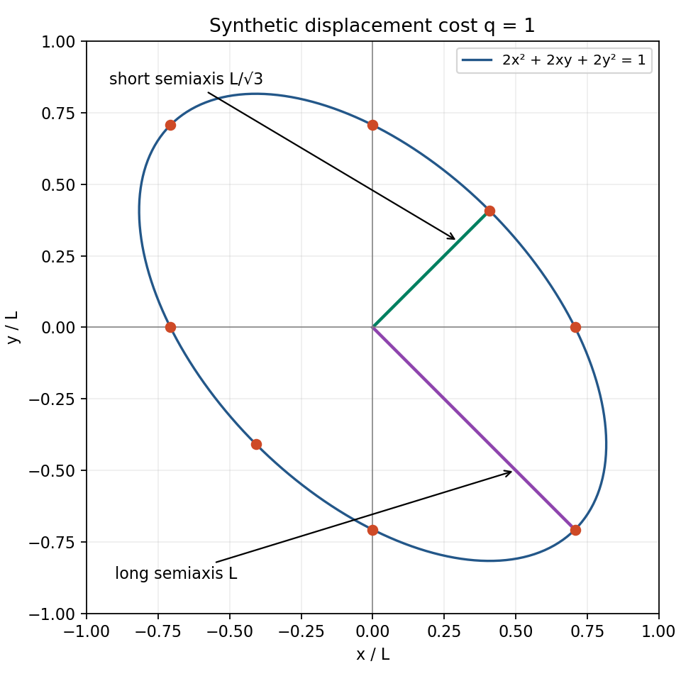

# Lesson 1 — A quadratic form as a directional cost

**Essential question:** How can equal-length moves have different costs?

**Goals:** Evaluate a two-coordinate quadratic form; explain its cross term and positivity; plot a constant-cost contour with correct units.

**Prerequisite bridge.** You need signed arithmetic, squares and coordinate graphs. A vector is an ordered list of components: (1,2) means one step along the first axis and two along the second. Its squared length is 1²+2²=5. A square root reverses squaring for nonnegative numbers, so its length is √5. We will teach the matrix notation here, even if you met it in courses 10 or 17. No calculus is required. Use L for one chosen length unit and τ for one chosen time unit throughout the synthetic examples; L and τ are units, not changing variables.

Two 55-minute sessions: first evaluate forms, then draw their contours. Each session uses 5 minutes retrieval, 20 explanation/example, 15 practice and 15 diagnostics/repair.

## C27.01-E1 — Build the form from arithmetic

A matrix is a rectangular table of numbers. A column vector lists components vertically. Multiplication of a matrix by a column means taking each row, multiplying matching entries, and adding. With our **synthetic** matrix

G = [[2,1],[1,2]] L⁻²,

the product G(x,y) has components (2x+y, x+2y), with the units carried separately. The superscript T means transpose: a column becomes a row. Therefore the scalar (one-number) expression zᵀGz means multiply G by z and then take matching products with z and add. In numerical coordinates,

q(z)=2x²+2xy+2y².

The cross term is 2xy because the upper-right entry gives xy and the lower-left entry gives another xy. The matrix is symmetric: entries across its diagonal agree. A positive form gives a strictly positive result for every nonzero vector and zero for the zero vector. Here

q(z)=(x+y)²+x²+y².

All three squares are nonnegative; if their sum is zero, x=y=0. This proves positivity without relying on a drawing. For a displacement z=(x,y)L, q is dimensionless because L·L⁻²·L=1. For a velocity v=(x,y)L/τ, q(v) has units τ⁻². A positive value alone does not choose which physical quantity the number represents.

## C27.01-W1 — Equal lengths, different costs

A unit direction has length one. Along e₁=(1,0), the directional numerical value is 2. Along n₊=(1,1)/√2, each coordinate square is 1/2 and the product is 1/2, giving 1+1+1=3. Along n₋=(1,−1)/√2 the product is −1/2, giving 1−1+1=1. These direction evaluations have units L⁻² when the vectors themselves are dimensionless; displacements of length L in those directions have dimensionless costs 2, 3 and 1.

Scaling a displacement by a number a scales every quadratic term by a². The distance along n₊ needed for q=1 is therefore L/√3, since 3(1/√3)²=1. Along n₋ it is L. To see why the whole contour is an ellipse, write a displacement as s n₊+t n₋, where s,t are lengths. Substituting x=(s+t)/√2 and y=(s−t)/√2 into q gives (3s²+t²)/L². Thus q=1 becomes 3(s/L)²+(t/L)²=1, an ellipse in rotated axes. Its principal semiaxes are L/√3 and L.

Plot these anchors on ordinary x/L,y/L axes and join smoothly in the indicated order. Both coordinate axes must use the same scale.

| Around the contour | x/L | y/L |
|---|---:|---:|
| diagonal short end | 1/√6 | 1/√6 |
| vertical crossing | 0 | 1/√2 |
| diagonal long end | −1/√2 | 1/√2 |
| horizontal crossing | −1/√2 | 0 |
| opposite short end | −1/√6 | −1/√6 |
| opposite vertical crossing | 0 | −1/√2 |
| opposite long end | 1/√2 | −1/√2 |
| final horizontal crossing | 1/√2 | 0 |

The contour is stretched along the downward-sloping diagonal because that direction costs less per equal length. Keep the exact coordinates; decimals are optional display values.

## C27.01-P1 — Practice, then check

Evaluate the form for velocities (1,2)L/τ and (1,−1)L/τ. Reverse both vectors and retain their signed components. Test whether diag(1,−1)L⁻² is positive. Finally plot the eight anchors above and label both principal semiaxes.

**Worked answers:** q(1,2)=2+4+8=14/τ². q(1,−1)=2−2+2=2/τ². Reversals (−1,−2) and (−1,1) give 14/τ² and 2/τ² because both factors in every product reverse. The original vectors cannot be reconstructed from the scalar alone, so retain them. For the alternative matrix, (0,1)L gives −1, disproving positivity. The plotted long axis joins (−1/√2,1/√2) to (1/√2,−1/√2); each endpoint is L from the origin. The short-axis endpoints are L/√3 from the origin.

> **Claim scope:** G here is a classroom matrix, not the source's locked G_phase. A directional cost is a defined scalar, not automatically energy or force. In the source, G_phase and M_cell=BᵀB have distinct definitions [S02, typed_conventions; sources.md].

## C27.01-D1 — Diagnostic checks

1. Why is the cross term 2xy rather than xy?
2. If a displacement doubles, how does cost change?
3. Does q(v)=q(−v) imply that the signed velocities are identical?
4. What are the units for displacement input and velocity input?

**Answers:** (1) Both off-diagonal entries contribute xy. (2) Every term gains a factor 4. (3) No; the scalar loses direction, so save both components. (4) Dimensionless for displacement; τ⁻² for velocity under this G's L⁻² typing.

**Next dependency:** [Lesson 2](lesson-02.md) constructs such a form from plane-count rulers.
