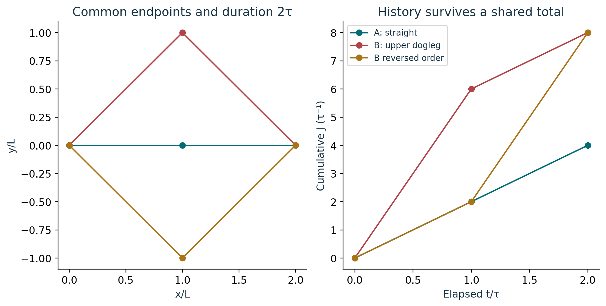
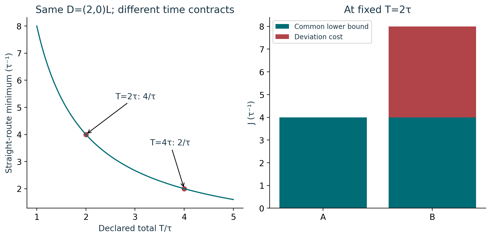

# Course 27: publication visual companion

These publication-added teaching figures accompany the preserved lessons. Numerical illustrations are synthetic unless a caption explicitly identifies a source-defined mathematical object. Plot coordinates are derived from the stated inputs; exact values and source scope remain in the linked lessons.

## Figure 27.1: Pullback of the cost contour

![Synthetic lesson-03 map z=B u/2 with B=diag(2,1) L, G=[[2,1],[1,2]] L^-2 and W=[[2,1/2],[1/2,1/2]].](publication-figures/pullback-of-the-cost-contour.png)

The same cost-one displacements are shown in two coordinate descriptions. Since u=(z1/L,2z2/L), the second coordinate doubles in the right panel. Both off-diagonal terms in W are retained, and the two factors of 1/2 produce the factor 1/4 in B transpose G B/4. Matching highlighted points have the same scalar cost.

Lesson connection: [1](lesson-01.md), [3](lesson-03.md). Consult those lessons and [source provenance](sources.md) for exact source addresses and evidence classes.

## Figure 27.2: Route and cumulative cost

A costs 4/τ. Both doglegs cost 8/τ, but their first cumulative costs are 6/τ and 2/τ and their intermediate positions differ. The cumulative graph alone still does not retain signed velocities; keep it with the full segment ledger. Subdivision at unchanged velocity leaves each segment contribution unchanged when recombined.

Lesson connection: [4](lesson-04.md), [5](lesson-05.md). Consult those lessons and [source provenance](sources.md) for exact source addresses and evidence classes.

## Figure 27.3: Fixed time bound and retained deviations

For each separately fixed duration, the straight route attains D transpose G D/T=8/T in the declared units. At T=2τ, B’s signed deviations (0,1) and (0,-1) L/τ give excess 4/τ. With an obstacle excluding the straight route, the algebraic lower bound survives but this plot no longer supplies an attaining feasible route.

Lesson connection: [5](lesson-05.md), [6](lesson-06.md), [7](lesson-07.md). Consult those lessons and [source provenance](sources.md) for exact source addresses and evidence classes.
