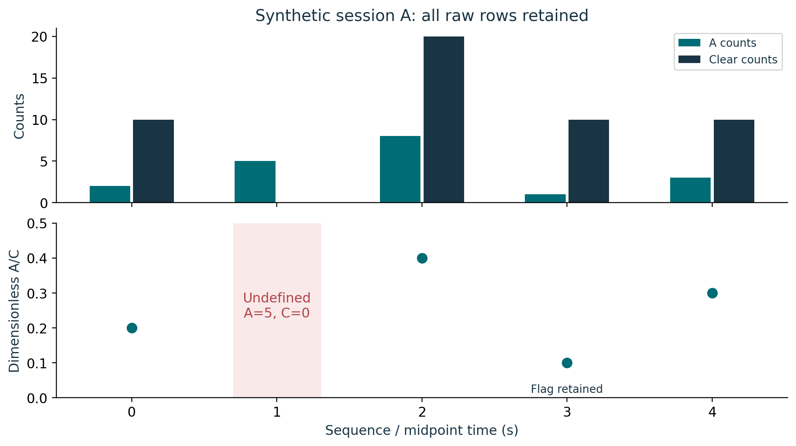
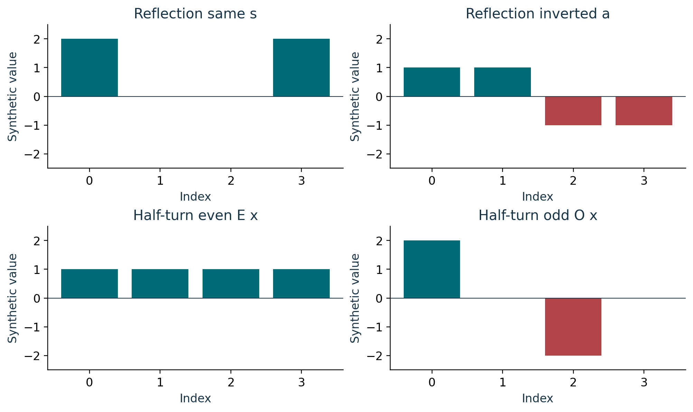
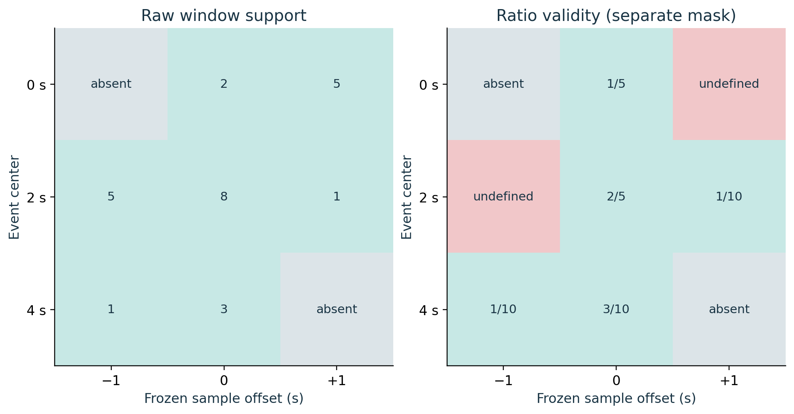

# Course 28: publication visual companion

These publication-added teaching figures accompany the preserved lessons. Numerical illustrations are synthetic unless a caption explicitly identifies a source-defined mathematical object. Plot coordinates are derived from the stated inputs; exact values and source scope remain in the linked lessons.

## Figure 28.1: Normalization preserves invalid row

The valid ratios are 1/5, 2/5, 1/10 and 3/10. Multiplying each by its same-row Clear value reconstructs A. Sequence 1 retains (5,0) directly. The stipulated sequence-3 diagnostic flag is independent of ratio validity and remains attached even though 1/10 is defined.

Lesson connection: [1](lesson-01.md), [2](lesson-02.md), [3](lesson-03.md). Consult those lessons and [source provenance](sources.md) for exact source addresses and evidence classes.

## Figure 28.2: Reflection and half turn are distinct

Reflection R reverses the index order about the center between 1 and 2. Half-turn H shifts by two positions on a periodic circle. They yield different component pairs: s+a=x and E x+O x=x. An even comparator (p,q,p,q) has dot product zero with (2,0,-2,0), so the nonzero odd field must be preserved.

Lesson connection: [4](lesson-04.md), [6](lesson-06.md). Consult those lessons and [source provenance](sources.md) for exact source addresses and evidence classes.

## Figure 28.3: Frozen windows and parallel masks

The center-2 raw window (5,8,1) is complete; its ratio window is incomplete because Clear at t=1 s is zero. Edge absence and undefined division have different colors and labels. All three windows remain, including the partial edges. Exposure support and the shared clock-offset interval are additional timing fields rather than replacements for these sample masks.

Lesson connection: [5](lesson-05.md), [7](lesson-07.md), [8](lesson-08.md). Consult those lessons and [source provenance](sources.md) for exact source addresses and evidence classes.
